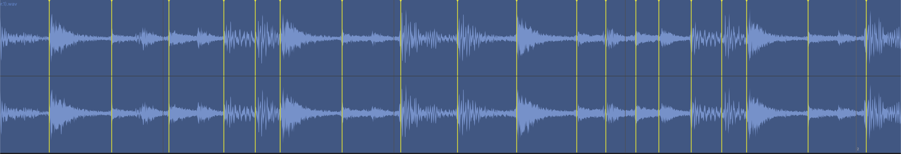
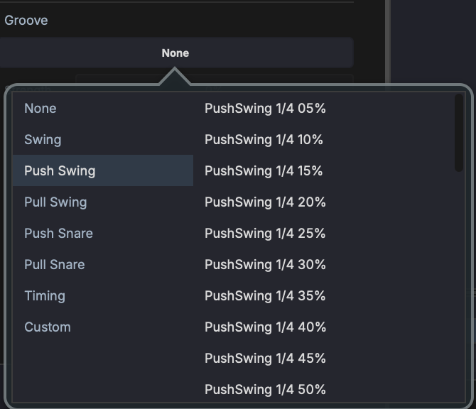
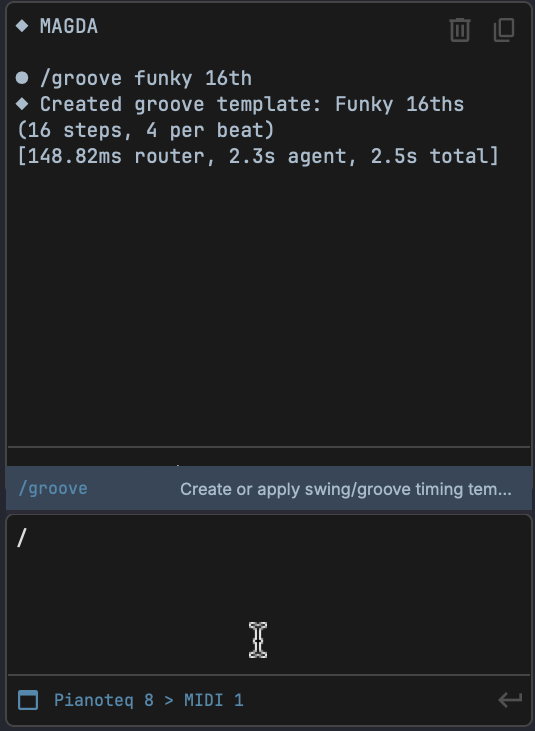

# Clips

Clips are the containers that hold audio and MIDI data on tracks. They appear as rectangular blocks in the Arrangement View timeline and as trigger pads in Session View.

## Clip Types

| Type | Description |
|------|-------------|
| **Audio** | Contains a reference to an audio file (WAV, AIFF/AIF, FLAC, OGG, MP3 where a platform decoder is available) with start/end points and gain |
| **MIDI** | Contains MIDI note and automation data |

Because MAGDA uses a [hybrid track system](tracks.md#hybrid-track-system), an audio track can hold both audio and MIDI clips. Group, aux and separator tracks take no clips.

## MIDI Clip Properties

The [Inspector](panels/inspector.md) shows a clip's properties in collapsible sections.

| Property | Description |
|----------|-------------|
| **Name** | Display name of the clip |
| **Colour** | Clip colour |
| **Start / End / Length** | Position and duration, in bars, beats and ticks |
| **Loop** | Loop the clip's contents. While it loops, **Phase** sets where playback starts inside the loop; otherwise **Offset** trims the start without moving the clip |
| **Transpose** | Buttons that move the clip's notes down or up an octave or a semitone (−12, −1, +1, +12). The notes themselves change |
| **Time Bend** | Bends when the clip's notes play, and loads grooves (see [Groove & Time Bend](#groove-time-bend)) |

## Audio Clip Properties

The Inspector groups these into **Clip**, **Warp & Pitch**, **Mix**, **Fades** and **Labels** sections. The [Waveform Editor](panels/waveform-editor.md)'s properties panel shows most of them too.

| Property | Description |
|----------|-------------|
| **Name** | Display name of the clip |
| **Colour** | Clip colour |
| **Start / End / Length** | Position and duration on the timeline |
| **Loop** | Loop the clip, with **Phase** or **Offset** as for MIDI clips (see [Looping](#looping)) |
| **Warp** | Turn on warp markers for per-segment time-stretching |
| **Beat / Free** | Follow the project tempo in bars and beats, or play at the file's own rate (see [Audio Clip Modes](#audio-clip-modes)) |
| **Stretch engine** | The time-stretch algorithm (see [Time-Stretch Engine](#time-stretch-engine)) |
| **Transient sensitivity** | How readily transients are detected in the source |
| **Tempo** | The source file's tempo in BPM, with ÷2 and ×2 buttons, and its length in beats |
| **Speed** | Playback speed factor from 0.25x to 4.0x (Free only) |
| **Analog** | Resample instead of time-stretching for pitch changes (Free only) |
| **Pitch** | Pitch shift in semitones (−48 to +48) and cents |
| **Key** | The source's key |
| **Volume** | Clip volume in dB |
| **Gain** | Additional boost from 0 to +24 dB |
| **Pan** | Stereo position from L to R |
| **Reverse** | Play audio backwards |
| **Gain envelope** | Show the clip's gain envelope (see [Gain Envelope](#gain-envelope)) |
| **Fades** | Fade-in and fade-out lengths, each with a curve (Linear, Convex, Concave, S-Curve) and a behaviour (Gain Fade or Speed Ramp) |
| **Auto-crossfade** | Crossfade automatically where clips overlap (the switch in the Fades header) |
| **Labels** | Named regions and points on the source (see [Labels](panels/waveform-editor.md#labels)) |

## Session Clip Properties

Both MIDI and audio clips in Session View have additional launch and follow properties, in the Inspector's **Launch** section:

| Property | Description |
|----------|-------------|
| **Quantize** | Quantize launch timing (None, 8 Bars, 4 Bars, 2 Bars, 1 Bar, 1/2, 1/4, 1/8, 1/16) |
| **Follow action** | What happens when the clip finishes: None, Play Next, Play Previous, Play Random, Stop, or Play Again |
| **Delay (beats)** | Delay before the follow action fires (0 - 64 beats, 0.25-beat resolution) |
| **Loops** | Number of times the clip loops before the follow action fires |

!!! note
    Session clips do not have an absolute position property; they are not placed on the timeline. Their position is determined by the scene slot they occupy.

### Follow Actions

Follow actions chain session clips together for generative arrangement. Once the clip has played the configured number of loops (plus any follow delay), the chosen action fires:

- **Play Next** triggers the next slot in the same track column
- **Play Previous** triggers the previous slot in the same track column
- **Play Random** triggers another slot in the same track column at random
- **Play Again** retriggers the current clip
- **Stop** stops session playback

## Creating Clips

- **Double-click** an empty area on a track to create a new 1-bar MIDI clip at that position
- **Double-click** over a time selection to create a MIDI clip matching the selection length
- ++alt++ **+ drag** on an empty track lane to draw a MIDI clip of variable length. The drag distance sets the clip length (snapped to the current grid). The arrangement's Pencil tool does the same.

## Selecting Clips

- **Click** a clip to select it
- ++cmd++ **+ click** (++ctrl++ **+ click** on Windows/Linux) to add or remove clips from the selection
- ++cmd+a++ (++ctrl+a++ on Windows/Linux) selects all clips in the arrangement, or all notes when a MIDI editor is focused
- **Double-click** a clip to open the bottom editor panel on it, and double-click again to close it. Selecting a clip switches the panel to the right editor but never reopens a panel you collapsed — the panel stays as you left it until you double-click a clip or use the collapse button in the footer.

## Editing Clips

- **Move** — Drag a clip to reposition it on the timeline or move it to another track
- **Nudge** — With clips selected, ++shift+arrow-left++ / ++shift+arrow-right++ moves them one grid step along the timeline, and ++shift+arrow-up++ / ++shift+arrow-down++ moves them to the neighbouring track. The whole selection moves together, keeping its spacing, and stops rather than piling up when it reaches the first track, the last track, or the start of the timeline. With snap on, the move lands on the grid; with snap off it steps by one grid unit from wherever the clip sits.
- **Resize** — Drag the left or right edge of a clip to trim its start or end point
- **Duplicate** — Hold ++alt++ and drag a clip, or press ++cmd+d++
- **Duplicate with or without automation** — Right-click a clip and choose **Duplicate With Automation** to copy the clip together with the automation under it, or **Duplicate Without Automation** to copy just the clip. Plain **Duplicate** behaves the same as the menu's default.
- **Split** — Use **Edit > Split / Trim** or press ++cmd+e++ to split the clips at the edit cursor. With a time selection, it splits them at the selection's edges instead. The clip's right-click menu has the same **Split / Trim** item.
- **Delete** — Select the clip and press ++delete++ or ++backspace++
- **Erase under cursor** — ++shift+ctrl++ **+ click** a clip to delete it directly without selecting first. If the clip is part of a multi-selection, the whole group is erased. Acts as a rubber tool.
- **Duplicate as ghost** — Right-click and choose **Duplicate as Ghost**, or hold ++alt+shift++ and drag, to create a linked copy. See [Linked (Ghost) Clips](#linked-ghost-clips).
- **Enable / disable** — Right-click and choose **Disable Clip** or **Enable Clip**, or press ++0++. See [Enabling and Disabling Clips](#enabling-and-disabling-clips).

Clips on a [frozen track](tracks.md#freezing-tracks) can't be edited until the track is unfrozen.

## Cut, Copy, and Paste

- ++cmd+x++ — Cut the selected clip(s)
- ++cmd+c++ — Copy the selected clip(s)
- ++cmd+v++ — Paste at the playhead position on the same track

## Linked (Ghost) Clips

A ghost clip is a linked copy: every clip in a link group shares the same underlying content, so editing one updates them all. Use them for a chorus that repeats, a drum pattern reused across a song, or a riff you want to develop in one place and hear everywhere.

Create one by right-clicking a clip and choosing **Duplicate as Ghost**, or by holding ++alt+shift++ and dragging a copy off the original. (Plain ++alt++-drag makes an ordinary, independent duplicate.) The same command is available from the Edit menu as **Duplicate Clip as Ghost**.

Ghost clips are drawn translucently, with their waveform or notes dimmed, a small link glyph in the header, and an italic name with a per-instance index appended (e.g. *Riff #2*). A link group with only one clip left is inert and shows no ghost styling.

**What is shared, and what is not:**

| Shared across the group | Independent per clip |
|---|---|
| Notes and audio content, takes, name | Position, length, and offset |
| Warp markers, labels and time-stretch mode | Playback speed (speed ratio) and loop settings |
| Tempo, key, and beat or free playback | Colour |
| Pitch, analog and reverse | Volume, gain, pan, and fades |
| Gain envelope, time bend, transient detection | Launch and grid settings, enabled/disabled state |

Editing any shared field on one member mirrors instantly to the rest; the independent fields let each ghost sit in its own place, at its own level, without disturbing its siblings.

To detach a clip from its group, right-click it and choose **Make Unique**. The clip keeps its current content but stops tracking, and future edits to it (or to its former siblings) no longer propagate. Splitting a ghost clip detaches both halves automatically.

## Enabling and Disabling Clips

Disabling a clip removes it from playback without deleting it. Right-click a clip and choose **Disable Clip** (or **Enable Clip** to bring it back), or press ++0++ with clips selected. A disabled clip is greyed out with a hatch, so it reads as "off" at a glance, and it is excluded from the playback graph so it produces no sound.

The enabled state is per-clip: disabling one member of a [link group](#linked-ghost-clips) does not silence its ghost siblings.

## Overlapping clips

Arrangement clips stack rather than erase each other. Drag a clip onto one that is already there and the clip underneath keeps its position and its full contents; it is covered, not trimmed. Move the covering clip away again and the material underneath comes back on its own, because what a clip plays is worked out from the lane each time rather than stored.

The clip on top owns the span it covers, and the one underneath plays what is left. A clip covered end to end plays nothing while staying exactly where it is. Which clip is on top is set when you place or move it, so the most recently moved clip wins, and the lane draws in that same order: what you see stacked is what you hear.

Where a cover lands decides what the clip underneath becomes:

- **Overlapping an edge** shortens it. The audible span pulls in to the edge of the cover, which is a shorter clip rather than a hole in one.
- **Landing strictly inside it** leaves a hole. The clip keeps its start and end and goes silent across the covered span only. A MIDI clip plays around the hole by dropping the notes that start inside it; an audio clip carries the hole through to playback. Nothing is cut and nothing is split, so the material comes back intact when the cover moves away.

A clip you disabled by hand covers nothing, because it is already silent. Letting it occlude would silence the clip below on behalf of silence.

### Play Through Overlap

To make both clips sound where they overlap, right-click either one and tick **Play Through Overlap**. The lane hatches the shared span to show it is playing both.

Either clip can carry the switch, which matters because the clip you reach for when something goes quiet is the one that went quiet, and that is the one underneath.

Asking for a [crossfade](#crossfades) turns it on for you, on both clips: right-click and choose **Crossfade with Previous Clip** or **Crossfade with Next Clip**, or drag a crossfade handle. Asking for a fade region is asking for both clips to be heard across it, so the gesture sets the fade and the play-through together.

With **New projects: overlap plays both** on (**Settings > General**, under Behavior), new clips in a new project start with **Play Through Overlap** ticked.

!!! note "The Auto-crossfade switch does not do this"
    **Auto-crossfade** marks a clip as eligible to crossfade; it does not create a fade region, and it leaves play-through alone. The same goes for **New projects: auto-crossfade** in **Settings > General**, which only decides whether new clips in a new project start with that property on.

    This matters because auto-crossfade cannot keep a covered clip audible on its own. It shapes an overlap that is already playing both, so audio fades into audio instead of both running flat. **Play Through Overlap** is what decides whether both sound; the crossfade only decides how they meet.

## Flatten MIDI Loop

When a MIDI clip is looping, right-click it and choose **Flatten MIDI Loop** to write the repetitions out as real notes. The loop cycles (including any offset phase) are baked into actual MIDI across the clip's full length, looping is switched off, and the offset resets to zero. The clip stays a MIDI clip in place, ready for per-note editing in the [Piano Roll](panels/piano-roll.md); the operation is a single undoable step.

## Audio Clip Modes

An audio clip plays in one of two ways, **Beat** or **Free**. Choose with the **Beat | Free** switch in the Inspector's **Warp & Pitch** section, or the **BEAT** toggle in the [Waveform Editor](panels/waveform-editor.md)'s properties panel. [Warp markers](#warp-markers) work on top of either.

### Free

The clip plays at the file's own rate, unaffected by the project tempo. Changing the project tempo does not stretch or compress it. **Speed** changes how fast it plays, and with **Analog** on, pitch changes resample the audio like tape instead of time-stretching it.

### Beat

Locks the clip to a musical length (e.g. 4 bars). When the project tempo changes, MAGDA time-stretches the audio so it always fills the same number of bars. Use this for loops, drum patterns, and rhythmic material that should stay in sync with the project.

Beat mode needs the file's tempo, shown in the **Tempo** field, where ÷2 and ×2 fix a detection that landed at half or double speed. If MAGDA can't detect a tempo and **BEAT without a detected tempo uses the project tempo** is on (**Settings > General**, under Behavior; on by default), the clip enters beat mode at the tempo it is heard at and a message tells you what was assumed; edit **Tempo** to correct it. With the option off, MAGDA asks you to type the BPM instead.

Beat mode doesn't loop the clip by itself. A beat-mode clip can follow the tempo and play once, ending where its source file ends.

### Looping

Only beat-mode clips loop. Turning **Loop** on for a free clip puts it into beat mode first, at the tempo it is heard at (the project tempo divided by its speed), so it sounds the same; a file that already has a tempo keeps it. The clip keeps its length and loops what it shows. Turning beat mode off ends an arrangement clip's loop.

Audio clips in Session View slots are always in beat mode, and BEAT can't be turned off there. Free clips that looped in a project from an earlier version of MAGDA open in beat mode and sound as they did.

### Warp Markers

Turn on **Warp** for per-segment time-stretching using **warp markers**. Each marker pins a point in the audio to a specific position on the timeline. The audio between markers is independently stretched or compressed. This is the most flexible mode — use it to align a free-tempo recording to the grid, fix timing, or create creative effects.



Warp markers are edited in the [Waveform Editor](panels/waveform-editor.md):

- **Add a warp marker** — Choose the **Marker** tool in the editor's toolbar and click the waveform. A dotted guide shows where it will land.
- **Move a warp marker** — Drag it left or right to stretch the audio on either side. ++alt++ + drag moves the marker without stretching.
- **Delete a warp marker** — Double-click it, or right-click it and choose **Remove Warp Marker**

### Slicing

Right-click an audio clip to access slice operations. These split the clip into multiple pieces based on warp markers or the current grid setting.

- **Slice at Warp Markers In Place** — Split the clip at each warp marker position, creating separate clips on the same track. Requires warp mode with at least one user-placed marker.
- **Slice at Grid In Place** — Split the clip at every grid line, creating separate clips on the same track.
- **Slice at Warp Markers to Drum Grid** — Create a new Drum Grid track where each slice between warp markers becomes a pad, with a MIDI pattern that reproduces the original timing.
- **Slice at Grid to Drum Grid** — Same as above but slicing at grid intervals instead of warp markers.

### Time-Stretch Engine

When Beat or Warp mode is active (or whenever a clip is otherwise stretched or pitched), the audio is time-stretched by a selectable engine, set per clip:

| Engine | Notes |
|---|---|
| **Signalsmith** | Default. Modern, general-purpose stretcher with clean transients. |
| **SoundTouch** | Lighter-weight classic algorithm. |
| **SoundTouch HQ** | Higher-quality SoundTouch variant at more CPU cost. |
| **Off** | No stretch engine; the clip is left unprocessed. |

Choose the engine from the stretch engine dropdown in the Inspector's **Warp & Pitch** section or from the **Mode** dropdown in the [Waveform Editor](panels/waveform-editor.md)'s properties panel. New clips default to **Signalsmith** as soon as stretching becomes active.

## Gain Envelope

An audio clip can carry a gain envelope: a volume curve drawn over the clip, from silence up to +6 dB. It rides on the sound itself, so its points stay with the same audio when you trim, reverse, loop or stretch the clip. Linked ghost clips share it, and it is saved with the project.

Show it with any of these, which all set the same switch on the clip:

- the gain envelope button in the [Waveform Editor](panels/waveform-editor.md#gain-envelope) toolbar
- **Show Gain Envelope** in the clip's right-click menu
- ++e++ with audio clips selected
- the **Gain envelope** toggle in the Inspector's **Mix** section

Showing it is a view setting, not an undo step. While it is shown, the clip's waveform dims and the envelope draws over it, both in the Waveform Editor and on the clip in the arrangement. An empty envelope is a flat 0 dB line. On the arrangement clip you edit it with the Waveform Editor's current envelope tool; the clip's trim edges and fade handles keep working, and right-clicking still opens the clip menu.

## Groove & Time Bend

A MIDI clip can carry a time bend: a curve that moves when its notes play, without changing the notes as written. Grooves are ready-made bends. Open it in the Inspector's **Time Bend** section, or with the Time Bend button in the [Piano Roll](panels/piano-roll.md) toolbar.

{ width="300" }

Above the curve:

- **GROOVE** loads a groove at full strength, from the Swing, Push Swing, Pull Swing, Push Snare, Pull Snare, Timing and Random families, or your own under **Custom**. **AMOUNT** sets how much of it you hear, and **None** turns it off.
- **BAKE** writes what the bend plays into the notes and turns the bend off.

See [Time Bend](time-bend.md) for editing the curve itself.

### Creating Grooves with AI

You can create custom grooves using the `/groove` slash command in the AI Assistant:

{ width="400" }

```
/groove funky 16th
```

The AI generates a groove from your description. Created grooves appear under **Custom** in the GROOVE menu.

### Groove via DSL

You can also list and apply grooves with DSL code, run through the `/dsl` command in the AI Assistant. `strength` sets the bend's AMOUNT:

```
groove.list()
groove.set(template="Basic 8th Swing", strength=0.5)
```

## Transcribe Audio to MIDI

MAGDA can detect the notes in an audio clip and turn them into MIDI. Right-click an audio clip and choose **Transcribe to MIDI**: the audio is analysed and a MIDI clip of the detected notes is created, ready to drive an instrument. It works on a single audio clip at a time and needs the clip's source file on disk.

Transcription works best on clearly pitched, reasonably clean material (a solo vocal, a bassline, a lead). Dense mixes and heavily layered audio give rougher results that usually want some cleanup in the [Piano Roll](panels/piano-roll.md).

!!! note "Intel macOS"
    Transcription runs on the ONNX runtime, which is not part of the Intel macOS build. On those builds **Transcribe to MIDI** is greyed out.

## Split into Stems

Right-click an audio clip and choose **Split into Stems** to separate it onto new tracks — vocals, drums, bass and other with Demucs, vocals against everything else with Spleeter, or harmonic against percussive content with the download-free HPSS engine. The stem tracks appear in a group beneath the source, the source track is muted, and each stem clip keeps the original's position, stretch mode, and warp markers.

See [Stem Separation](stem-separation.md) for the engines, the model downloads, and where the rendered files land.

## Crossfades

A crossfade is a real overlap between two adjacent audio clips: the outgoing clip fades down as the incoming clip fades up across the shared region.

- **Create** - drag one audio clip so it overlaps its neighbour. With auto-crossfade active the overlap becomes a crossfade, drawn with an X across the shared region. You can also right-click a clip and choose **Crossfade with Previous Clip** or **Crossfade with Next Clip**.
- **Resize** - drag the fade handles at a crossfaded edge to lengthen or shorten the overlap.
- **Read and edit the length** - the crossfade shows as an editable **Crossfade in** or **Crossfade out** value, in beats, in the clip's Fades section. Dragging it to zero leaves the row in place so you can re-create the crossfade later.
- **Remove** - right-click the clip and choose **Remove Start Crossfade** or **Remove End Crossfade**.

Whether a clip crossfades automatically is its **Auto-crossfade** switch, in the header of the Inspector's Fades section. **New projects: auto-crossfade** in **Settings > General** decides whether new clips in a new project start with it on.

Selecting several audio clips at once keeps the [Waveform Editor](panels/waveform-editor.md) open in a multi-clip mode, where the fades section batch-edits all of them at once, including auto-crossfade.

## Freeze, Bounce, and Render

These operations render a track or clip's output to audio, useful for reducing CPU load or committing effects.

- **Freeze** — Render the track's output to an audio file and play that instead, until you unfreeze it. Right-click the track header and choose **Freeze Track**. See [Freezing Tracks](tracks.md#freezing-tracks).
- **Render Selected Clip** — On audio clips, right-click and choose **Render Selected Clip** (or **Render Selected Clip(s)** for several) to write the clip's speed, pitch, warp, fades, gain and trim into a new audio file and replace the clip with a plain clip playing it. Track and master plugins are not included.
- **Render Time Selection** — Right-click and choose **Render Time Selection**, or press ++cmd+shift+b++, to consolidate the time selection into a single clip on each track.
- **Bounce In Place** — On a MIDI clip on a track with an instrument, right-click and choose **Bounce In Place** to render it through the instrument only, with no effects, and replace it with an audio clip on the same track.
- **Bounce To New Track** — Right-click any clip and choose **Bounce To New Track** to render it through the track's full chain, instrument and effects, onto a new audio track below. The original is left unchanged. With several clips selected, each gets its own track.

Bounces cover the time selection when there is one, and otherwise the selected clips.
