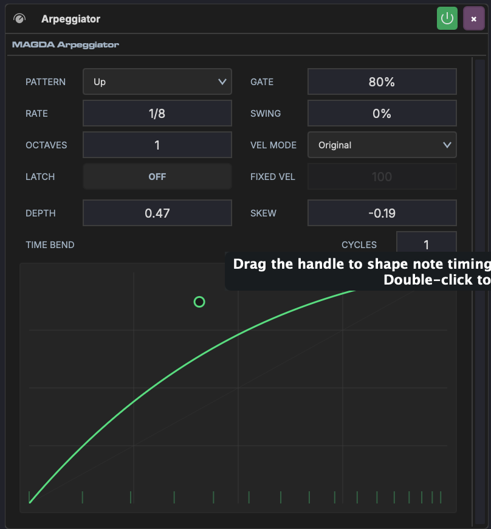

# Arpeggiator

The Arpeggiator is a MIDI device that takes held chords and plays them back as a rhythmic pattern — one note at a time, in a chosen order and rate.

## Overview

The Arpeggiator sits on a track's device chain before an instrument. It intercepts incoming MIDI chords and outputs arpeggiated note sequences. Hold a chord on your keyboard and the arpeggiator cycles through its notes at the configured rate and pattern.

## Parameters

The parameters sit in the device's grid; the sidebar's **Show the parameters** toggle hides or shows them.

### Pattern & Timing

| Parameter | Range | Description |
|-----------|-------|-------------|
| **Pattern** | Up, Down, Up/Down, Down/Up, Random, As Played | Note order within each cycle |
| **Rate** | 1/4D to 1/32, with dotted (D) and triplet (T) values | Speed of the arpeggio steps |
| **Octaves** | 1–4 | How many octaves the pattern spans before repeating |
| **Gate** | 1–100% | Note length as a percentage of the step duration. Lower values produce staccato; higher values produce legato. |
| **Swing** | 0–100% | Delays every other step for a shuffle feel |
| **Latch** | Off / On | When on, the arpeggio continues playing after you release the keys |

### Velocity

| Parameter | Range | Description |
|-----------|-------|-------------|
| **Vel mode** | Original, Fixed, Accent | How output velocity is determined. Original uses the played velocity; Fixed uses the Fixed vel value; Accent plays every fourth step harder than the rest. |
| **Fixed vel** | 1–127 | Velocity used when Vel mode is Fixed. It is dimmed in the other modes. |

### Time Bend

The Arpeggiator's faceplate is its [Time Bend](../time-bend.md) panel, shown or hidden with the **Show the time bend** toggle in the device's sidebar. It reshapes when each arpeggiated note plays within the cycle: instead of evenly spaced steps, notes can accelerate, decelerate, or cluster. Notes still play in the same order; only the rhythm changes.

The panel holds the time bend's read-head curve. Drag its points and bend its segments, right-click a point for a hard corner, or start from a **SHAPE**. The **TIME | DYNAMICS** switch draws a level per step instead, which scales each note's velocity as it plays; the arpeggiator's own velocities are left as they are. See [Time Bend](../time-bend.md) for the editor itself.

| Parameter | Range | Description |
|-----------|-------|-------------|
| **Bend** | 0–100% | How much of the time bend is heard (in the parameter grid) |
| **Cycles** | 1–8 | Repeats the curve within each arpeggio cycle (in the parameter grid) |
| **Quantize** | 0–100% | Pulls the bent notes back toward the Subdivision grid (beside the curve) |
| **Subdivision** | 16–512 | Divisions of the bend's cycle that Quantize pulls toward (beside the curve) |

The expand button in the panel's header moves the time bend into the arrangement, where it has room to be edited in detail. Its collapse button, or ++esc++, puts it back.

Bend and Cycles can be linked to [Macros](../modulation/macros.md) for automatable timing modulation — morph from straight to bent patterns in real time.

## MIDI pass-through

The Arpeggiator replaces the notes you play with its own pattern, and passes everything else on the channel to the instrument behind it — mod wheel, expression, sustain, pitch bend, aftertouch and program change all reach the synth unchanged. Sustain still holds the arpeggiated notes, and the wheel still bends them.

Turn on **MIDI thru** in the device header only when you want the chord itself to play alongside the pattern: thru passes the raw input on, notes included.

## Usage

1. Place the Arpeggiator before an instrument on a track's device chain
2. Play or input a chord — the arpeggiator breaks it into individual notes
3. Adjust Pattern, Rate, and Gate to shape the basic rhythm
4. Use the time bend to add rhythmic variation beyond simple swing
5. Enable Latch to keep the arpeggio running while you change chords
