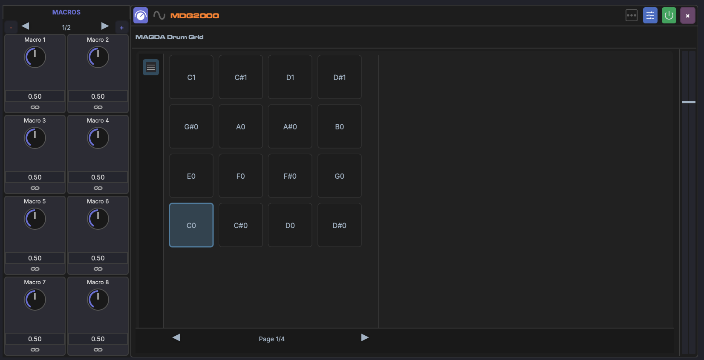

# Drum Grid

The Drum Grid is MAGDA's pad-based drum instrument. Each pad holds its own chain of devices, and each pad that holds a sound is its own mixer channel, giving you independent processing and mixing per drum voice.

## Overview

The Drum Grid maps incoming MIDI notes to 64 pads, 16 to a page. The device shows three panels side by side: the pads, the selected pad's panel with its mix, and the selected pad's chain. The sidebar's **Show the pad panel** and **Show the pad's chain** toggles hide or show the last two, and its arrows turn the pages of pads. Like other devices, the Drum Grid has a side strip with a meter and gain fader.

## Pads

- Each pad is mapped to a specific MIDI note and shows that note and the name of the sound it holds
- Pads can be triggered from the Piano Roll, the Drum Grid Editor (bottom panel), or a MIDI controller
- Click a pad to select it and show its panel and chain; the play button on a loaded pad auditions it
- Drag a pad onto another to swap the two
- Right-click a loaded pad for **Analyze pad role**, which classifies its sample with the Sample Analyzer models to set the pad's role, and **Delete**, which clears the pad

Pad **labels**, instrument **roles**, and **drumkits** are managed by right-clicking rows in the [Drum Grid Editor](../panels/drum-grid-editor.md#row-labels-and-roles).

## Pad Chain

Each pad has one chain of devices, just like a track. Its instrument comes first, typically a [Sampler](sampler.md) playing the pad's sample; effects follow it, so you can put distortion on a snare without affecting the kick. To layer several sounds on one pad, put a [rack](../fx-chain.md#racks) in its chain.

- Drop an instrument, a MAGDA one or a plug-in, on a pad to make it the pad's instrument. This replaces the pad's whole chain, effects included.
- Drop effects or samples on the chain panel to add them to the selected pad's chain. An empty pad's chain panel also has a **+** button for building a chain from scratch.

Plug-ins inside a pad's chain show one row of parameters fewer than at the top of a track's chain, so each value still fits under its name.

## Pad Channels

Each pad that holds a sound is a mixer channel nested under the Drum Grid's track. It appears as a row under the track in the arrangement, with no clip lane, and as a strip under the grid's strip in the [Mixer View](../mixer-view.md). A pad channel has volume, pan, mute, solo, sends, automation and a meter, like any track, and its device chain is the pad's chain: select the channel and the bottom panel shows the pad's chain, and devices you add while it is selected land there.

Empty pads have no channel. Clearing a pad removes its channel, and undo brings it back with its settings.

The pad panel in the device mixes the selected pad's channel:

- **Gain** — level, -60 to +6 dB
- **Pan** — stereo position
- **Mute pad**, **Solo pad** and **Pad power**

A pad channel's output goes to the grid by default: the pads are summed where the Drum Grid sits, before any effects that follow it on the track. Route a channel's output elsewhere and it leaves the grid's mix. Soloing a pad keeps the grid's track audible.

!!! note "Projects with pad buses"
    Earlier versions routed pads to bus tracks. Those projects open with each bus converted: a bus that carried one pad becomes that pad's channel, keeping its effects, sends, automation and output, and a bus that carried several pads becomes a group that their channels route into.

## Adding Samples

- Drag audio files from the Media Explorer onto a pad to load a sample. The pad's chain is replaced by a Sampler playing it, rooted on the pad's note. To add a sample to a pad's chain instead, drop it on the chain panel.

### Multi-Sample Drop

Select several samples in the [Media Explorer](../panels/browsers.md) or [Media Library](../panels/media-library.md) and drag them onto any pad. Samples fill consecutive pads in selection order, starting from the drop target. While dragging, every pad that will receive a sample lights up so you can see the range before releasing.

## Pad Envelope and Macros

Each pad's Sampler has an amplitude envelope you can shape per pad: **Attack**, **Decay**, **Sustain** and **Release**.

These envelope controls are full modulation targets. You can link them to the Drum Grid's [macros](../modulation/macros.md) and modulate them with LFOs or envelopes the same way as any other parameter (see [Linking Parameters](../modulation/linking.md)). Slicing a sample across several pads gives each slice its own envelope, so a single macro can, for example, tighten every slice's release at once.

## MIDI Mapping

The 64 pads run chromatically from C0 on the first pad, so the General MIDI drum notes land where drum maps expect them: kick on C1, snare on D1, and so on.
