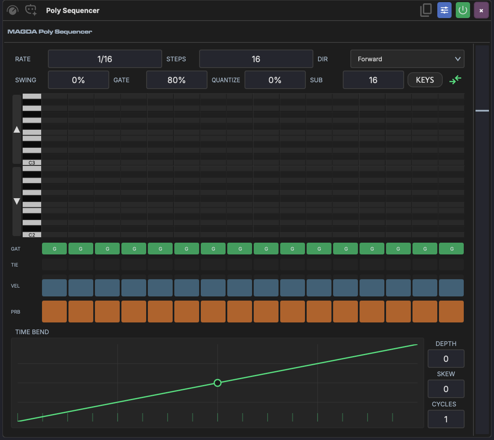

# Poly Sequencer

The Poly Sequencer is a polyphonic step-sequencer MIDI device. Where the [Step Sequencer](step-sequencer.md) plays one note per step, the Poly Sequencer can place a full chord — up to eight notes — on each step, and it switches between a melodic keyboard grid and a drum-lane grid.

The faceplate has the steps on the left and the [time bend](#time-bend) on the right. The sidebar's **Show the time bend** toggle hides or shows the time bend; the choice is saved with the device.

## Settings

A strip across the top of the steps holds the pattern's settings:

| Setting | Range | Description |
|--------|-------|-------------|
| **Rate** | 1/4. to 1/32, with dotted (.) and triplet (T) values | How fast the sequencer advances |
| **Steps** | 1–32 | Number of steps in the pattern |
| **Gate** | 5–100% | Default note length as a percentage of the step |
| **Dir** | Fwd, Rev, P-P, Rnd | Playback direction: forward, reverse, ping-pong or random |
| **View** | Keys, Drums | Switches the grid between the keyboard and drum lanes |

Right-click the strip or the step ruler for **Quantize** and **Quantize Sub**; see [Time Bend](#time-bend) below.

The device header holds **AI**, **Randomize pattern**, **Step record**, **MIDI thru** (passes incoming notes through to the downstream instrument), and **Copy** (*Click to copy pattern, drag to timeline*), the same buttons as on the [Step Sequencer](step-sequencer.md#header-buttons).

## Pattern Views

Under the settings strip, a ruler numbers the steps and lights the one playing. Below it sits the grid, in one of two views. When the device is too short for the grid, as at the device chain's standard height, a row of step boxes stands in for it. Each box names the step's note, its chord (such as `Am7`) or its note count; click a box to toggle notes on that step from a pop-up keyboard, or from a list of drums in the Drums view.

The expand button at the start of the ruler (*Expand into the arrangement*) lends the grid to the arrangement, where it has room to work, while the step boxes stay in the device. Only one faceplate can be out at a time. Its collapse button, or ++esc++, puts it back.

### Keys view

A piano-roll grid: rows are pitches (with a keyboard on the left), columns are steps. Click a cell to add or remove a note at that pitch and step — stack several in one column to build a chord. Notes draw as bars that run on through the steps tied to them. The up/down buttons beside the keyboard shift the rows by an octave, the +/− buttons zoom between one and four octaves, and the mouse wheel scrolls or zooms.

### Drums view

An x0x-style lane grid, one lane per drum sound. If a [Drum Grid](drum-grid.md) device sits downstream on the same track, the Poly Sequencer reads its pads and names the lanes to match; otherwise it falls back to a General MIDI drum map (Kick, Snare, CHat, OHat, LTom, MTom, Crash, Ride). Notes that don't match a lane appear as extra lanes you can still edit.

Right-click any step in either view for **Mute Step** (or **Unmute Step**), **Clear Step**, and a **Pattern** submenu (shift by a semitone or octave, clear the pattern).

## Per-Step Lanes

Below the grid, four lanes set values for every step:

- **Gate** — toggle the step's gate on or off.
- **Tie** — tie the step to the previous one so the note sustains without retriggering.
- **Velocity** — drag to set step velocity.
- **Prob** — drag to set the probability that the step fires, for humanised or evolving patterns.

## Time Bend

The [Time Bend](../time-bend.md) column reshapes step timing across the pattern, the same idea as in the [Step Sequencer](step-sequencer.md#time-bend) and [Arpeggiator](arpeggiator.md). Drag the curve's points and bend its segments, right-click a point for a hard corner, or start from a **SHAPE**. **GROOVE** loads a groove's curve; **AMOUNT** sets how much of the bend is heard and **CYCLES** repeats it within the pattern. The **TIME | DYNAMICS** switch draws a level per step instead, which scales each step's velocity as it plays; the velocities in the pattern are left as they are.

**Quantize** (0–100%, in the right-click menu) pulls the bent steps back toward a grid of **Quantize Sub** divisions (16–512) of the bend's cycle. The time bend has its own expand button, which moves it into the arrangement.

## AI Pattern Generation

Describe the pattern you want — "4-on-the-floor kick", "lo-fi seventh chords", "hi-hat rolls" — in the device's [AI panel](../panels/ai-assistant.md#per-device-ai-panel) and let its agent fill the grid. The agent reads the current view and, in the Drums view, the downstream drum lanes, so generated drum hits land on the right pads. Fields you leave alone in the request are preserved, so you can regenerate just the notes without losing your rate or step count.
