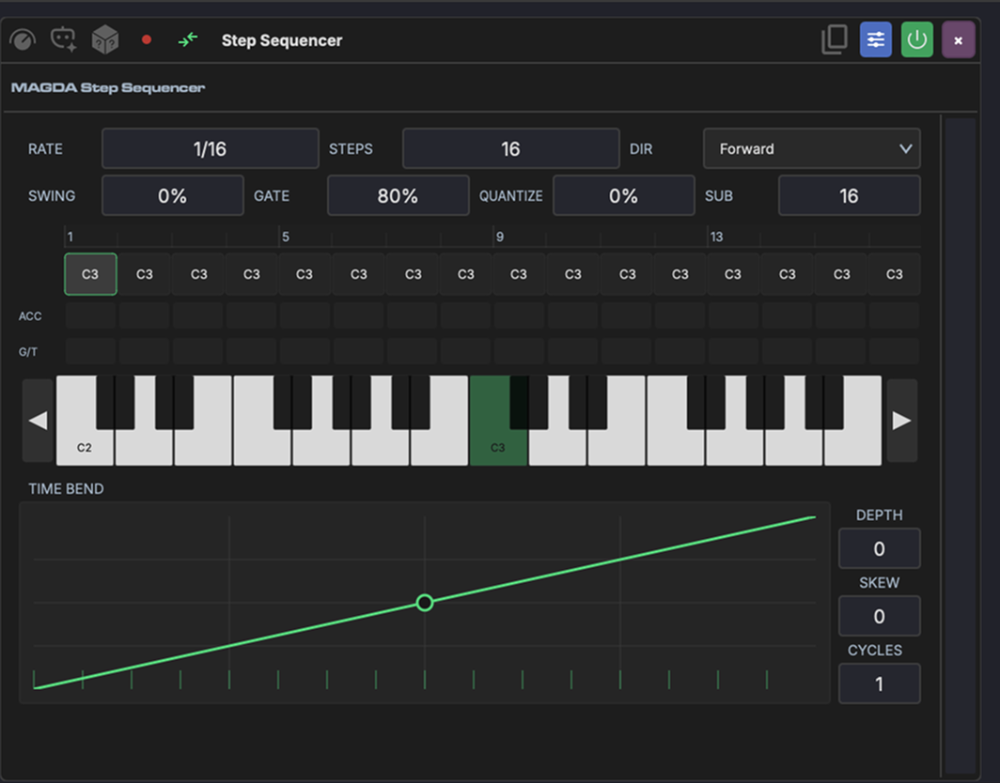

# Step Sequencer

The Step Sequencer is a MIDI device that generates melodic and rhythmic patterns from a row of up to 32 programmable steps. Each step has a note and switches for gate, tie, glide and accent — giving you precise control over every note in the sequence.

!!! tip "Need chords or a drum grid?"
    The Step Sequencer is monophonic — one note per step. For chords (up to eight notes per step) and a switchable keyboard/drum view, use the [Poly Sequencer](poly-sequencer.md).

## Overview

The Step Sequencer sits on a track's device chain before an instrument. It plays through a pattern of steps in sync with the project tempo, independent of any MIDI input. Steps can be programmed by clicking them, playing notes via step recording, or generating patterns with AI.

The faceplate has the steps on the left and the [time bend](#time-bend) on the right. The sidebar's **Show the time bend** toggle hides or shows the time bend; the choice is saved with the device.

## Settings

A strip across the top of the steps holds the pattern's settings:

| Setting | Range | Description |
|---------|-------|-------------|
| **Rate** | 1/4. to 1/32, with dotted (.) and triplet (T) values | How fast the sequencer advances through steps |
| **Steps** | 1–32 | Number of steps in the pattern |
| **Gate** | 5–100% | Note length as a percentage of the step duration |
| **Dir** | Fwd, Rev, P-P, Rnd | Playback direction: forward, reverse, ping-pong or random |

Right-click the strip or the step ruler for the settings that have no box of their own:

- **Quantize** and **Quantize Sub** — see [Time Bend](#time-bend) below.
- **Velocity** — the velocity of ordinary steps, 1–127.
- **Accent Velocity** — the velocity of accented steps, 1–127.

## The Steps

Under the settings strip, a ruler numbers the steps and lights the one playing. Below it, each step has a note box, then four rows of switches. Click a switch to toggle it:

- **Gate** — whether the step plays. A rest shows as a dot in its note box.
- **Tie** — carries the previous note on through the step instead of retriggering it.
- **Glide** — holds the step for its full length so the next note slides in from it. Tie and glide exclude each other.
- **Accent** — plays the step at the Accent Velocity.

Click a note box to pick the step's note from a pop-up keyboard. When the device has the height for it, a keyboard under the note boxes sets the selected step's note instead, with **Octave** buttons to move it.

++shift++-drag one note box onto another to copy that step. Right-click a step for **Mute Step** (or **Unmute Step**), **Copy to All Steps**, **Clear Step** and **Clear Pattern**.

The expand button at the start of the ruler (*Expand into the arrangement*) lends the note editor to the arrangement, where it becomes a piano roll with a column per step. Click a cell to put that step's note there, and click it again to rest the step; the mouse wheel scrolls and zooms the rows. Only one faceplate can be out at a time. Its collapse button, or ++esc++, puts it back.

## Time Bend

The [Time Bend](../time-bend.md) column reshapes step timing within each cycle, the same way it works in the [Arpeggiator](arpeggiator.md). Steps that would normally fire on a rigid grid follow the curve instead — compressing some and expanding others.

Drag the curve's points and bend its segments, right-click a point for a hard corner, or start from a **SHAPE**. **GROOVE** loads a groove's curve; **AMOUNT** sets how much of the bend is heard and **CYCLES** repeats it within the pattern. The **TIME | DYNAMICS** switch draws a level per step instead, which scales each step's velocity as it plays; the velocities set on the device are left as they are. See [Time Bend](../time-bend.md) for the editor itself.

**Quantize** (0–100%, in the right-click menu) pulls the bent steps back toward a grid of **Quantize Sub** divisions (16–512) of the bend's cycle.

AMOUNT and CYCLES can be linked to [Macros](../modulation/macros.md) for real-time timing modulation. The time bend has its own expand button, which moves it into the arrangement.

## Header Buttons

The Step Sequencer's own buttons sit in the device header:

- **AI** — opens the device's AI panel; see [AI Pattern Generation](#ai-pattern-generation).
- **Randomize pattern** — fills the steps with a random pattern.
- **Step record** — enters [step recording](#step-recording).
- **MIDI thru** — passes incoming MIDI through to the downstream instrument alongside the sequencer output, so you can play live over the sequence.
- **Copy** (*Click to copy pattern, drag to timeline*) — click to copy the pattern, or drag it onto the timeline to make a MIDI clip of it.

## Step Recording

Click the step record button to enter step recording mode. Play a note on your MIDI controller and it will be placed on the current step, then the cursor advances to the next step. This is a fast way to input melodies without clicking the steps.

## AI Pattern Generation

The Step Sequencer can generate patterns using AI:

1. Click the **AI** icon in the device header to open its [AI panel](../panels/ai-assistant.md#per-device-ai-panel)
2. Type a description (e.g. "acid techno bassline") and press ++enter++
3. The agent fills the steps with a matching pattern

## Known Limitations

- **Arrangement loop boundary**: The Step Sequencer may produce a brief timing glitch when the arrangement transport loops back to the start. This does not affect session clips or non-looping playback.
