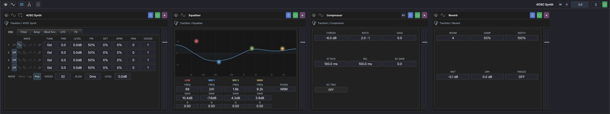
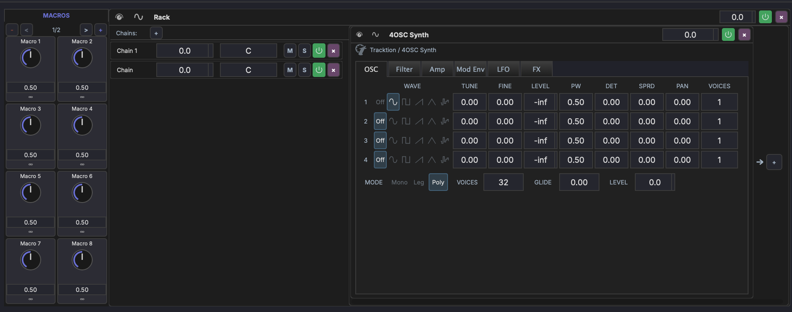

# FX Chain & Racks

Each track has an **FX chain** — an ordered list of audio processors applied to the track's signal.

## Overview

The FX chain is displayed in the bottom panel when a track or device is selected. Signal flows left to right through the chain. The header above the chain holds the track's own controls and presets; see [Track Chain](panels/track-chain.md) for each button.

The chain can contain:

- **Plugins** — VST3, AU, or VST effect and instrument plugins
- **Built-in devices** — MAGDA's own processors (see [Built-in Devices](devices/built-in.md))
- **Racks** — Container devices with nested chains and parallel routing, including multiband racks

## Working with Devices

- **Drag** plugins from the [Plugin Browser](panels/browsers.md) onto the chain to add them, or click the **+** at the end of the chain (*Add a device*) to pick one from a menu: **Internal** devices first, then plugins grouped by manufacturer
- **Drag** devices to reorder them in the chain; hold ++alt++ while dragging to **copy** instead of move (the cursor shows a copy badge)
- **Click** a device to select it; the selected device is highlighted in the accent colour. ++cmd++-click adds or removes a device from a multi-selection, ++shift++-click selects a range
- **++cmd+d++** duplicates the selected device(s) in place
- **++backspace++** or **++delete++** deletes the selected devices and racks. Devices have no delete button of their own
- **Right-click** a device for **Add to New Rack** (or **Add Selection to New Rack** when several are selected) and **Delete**. Both act on the whole selection when the device you click is part of it, and deleting several devices is a single undo step
- **Double-click** the background of a selected device to collapse it to a narrow strip; double-click again to expand it
- Plugin devices have a **Locate** button that finds the parameter matching a control you move in the plugin's own window — see [Plugin Parameters](plugin-parameters.md#locating-a-parameter)

See [Plugin Parameters](plugin-parameters.md) for per-plugin parameter visibility, custom units and ranges, and AI-assisted classification.

### Device Layout

Every device in the chain has the same height. Its parts:

- **Header** — on the left, the **Macros** and **Mods** buttons that open the device's [macro](modulation/macros.md) and [modulator](modulation/modulators.md) panels, plus routing buttons when the device has them (MIDI thru, sidechain source, multi-output routing). Then the [preset box](#presets) and the device name. On the right, plugin devices carry **Locate** and a button that opens the plugin's own window. A small MIDI light flashes green when a note arrives on the track's MIDI input, but only while the track [monitors its input](tracks.md#input-monitoring). With monitoring off, incoming notes leave it dark.
- **Sidebar** — down the left edge of the body, the toggles for the device's panels (for example its parameters or its faceplate) and the arrows that page through its parameters.
- **Side strip** — down the right edge, the device's power button at the top, then its peak meter with the gain fader over it. Effects with a dry/wet mix also show a **Dry / Wet Mix** knob, and effects carry the **Δ** [delta-solo](#delta-solo) button at the bottom. MIDI devices show a strip of incoming notes in place of the meter.

A plugin's parameter grid shows one row fewer when the plugin sits inside a rack or a Drum Grid pad, so each value still fits under its name.

### Device Power

The power button at the top of a device's side strip takes the device out of the signal path. A chain's power button does the same for every device in it. Both states are part of the project: they survive save and reload, and they are honoured when you render — a device that is powered off is powered off in an exported or bounced file too.

The gain fader in a device's or rack's side strip ignores the scroll wheel until you click it. This keeps a stray trackpad gesture over a device scrolling the chain rather than changing its gain. Once you have clicked the fader the wheel adjusts it, until the pointer leaves.

### Delta Solo

The **Δ** button at the bottom of an effect's side strip (tooltip *Delta Solo: processed signal minus dry input*) lets you hear only what that device changes: MAGDA subtracts the device's latency-aligned dry input from its processed output, so you audition the difference alone. It is the direct way to check exactly what a compressor, EQ, or saturator is doing to the signal.

Delta solo and bypass are mutually exclusive: turning on delta solo powers the device on, and powering the device off clears delta solo. The button lights cyan while active.

## Presets

Every device, and the track chain header, shows a **preset box** naming the current preset, with a **floppy disk** beside it. On both headers the preset sits before the name, between separators. The name of the current preset is saved with the project, so the box still shows it after you switch tracks or reopen the project.

### MAGDA Presets (.mps)

A MAGDA preset captures **everything MAGDA knows about the device** — parameter values, plugin state, macros, modulators, sidechain wiring, gain — in a single `.mps` file.

- **Load** — click the preset box. The menu lists the device's MAGDA presets, with categories as submenus and the current preset ticked. Loading replaces the device's state in place, keeping its slot in the chain.
- **Save** — click the floppy disk. It always asks for a name, pre-filled with the current preset's, and an optional category, which becomes a folder under the preset directory. Keep the name and press ++enter++ to overwrite the preset (MAGDA asks first); type a new name to save a copy.
- **Reveal in Finder** at the bottom of the menu opens the device's preset folder.

`.mps` is portable across MAGDA installations. The format is plugin-aware — loading a preset onto a slot whose plugin id doesn't match is rejected with a one-line error rather than silently overwriting state.

### Plugin Presets

A third-party plugin (VST3 / AU) uses the same menu, with its own entries after your MAGDA presets:

- **Plugin Presets** — the plugin's `.vstpreset` / `.aupreset` files, scanned from the standard preset directories. Your existing factory and user banks are picked up without a copy step.
- **Built-in Programs** — the programs the plugin itself exposes, when it has more than one.
- **Save as .vstpreset...** / **Save as .aupreset...** — save the plugin's current state as a plugin preset in its user preset folder.
- **Reveal Plugin Preset Folder** and **Rescan**.

The floppy disk always saves a MAGDA preset, on plugins as on every other device.

### Track Chain Presets

The preset box on the track chain header holds track presets. A track preset captures the **entire chain** — every device, every nested rack, every modulator binding — for a single track. Useful for stashing a finished mix-bus chain, a vocal chain, or a synth-and-FX combo and dropping it onto a fresh track later.

The box lists your track presets; loading one replaces the track's chain. The floppy disk asks for a name, pre-filled with the current one; use `/` to file it in a folder (for example `Bass/808 Stack`). Saving over an existing name asks first.

You can also drag a preset from the media browser onto the chain: a track preset replaces the chain, and a device preset is inserted where you drop it.

### Rack Presets

Racks keep a small chevron beside their name. Its menu lists your rack presets, followed by **Save "*name*"** (once a preset is loaded), **Save as MAGDA Rack Preset...** and **Reveal in Finder**.

## Racks

A rack is a container that holds one or more **parallel chains**. Signal flows into the rack, splits across chains, and mixes back together at the output.

### Creating a Rack

- Click { width="16" } **Add rack** in the track chain header, or **Add multiband rack** for a rack that splits the signal into frequency bands
- Right-click a device and choose **Add to New Rack** to wrap it in a new rack (**Add Selection to New Rack** wraps every selected device)

### Chains

A rack lists its chains on its left. With the **MIX** tab selected, each chain row has:

- **Volume** — Level control for the chain's output
- **Pan** — Stereo positioning of the chain
- **Mute** (M) / **Solo** (S) — Mute or solo individual chains
- **Power** and **remove** buttons

The **KEY**, **VEL** and **FADE** tabs show each chain's key range, velocity range, and range on the rack's **Chain select** control instead. The **VEL** tab also holds the round-robin switch. A rack inside a Drum Grid pad has no **KEY** tab, since the pad plays a single note.

Click **Add chain** at the bottom of the list to add a new parallel chain. Double-click a chain's name to rename it. The selected chain's devices show beside the list.

Select multiple chains with ++cmd++-click (toggle) or ++shift++-click (range). When more than one chain is selected, editing volume, pan, mute, solo, or bypass on any selected chain applies to the whole selection — volume and pan shift each chain by the same amount from its own value, so their relative balance is preserved.

### Use Cases

- **Parallel processing** — Blend dry and wet signals (e.g., parallel compression)
- **Multi-band processing** — Split signal into frequency bands with different processing
- **Organized grouping** — Keep related devices together in a collapsible container

### Rack Controls

- **Header** — the rack's **Macros** and **Mods** buttons, which open its own macro and modulator panels, then the name and the rack's preset chevron. The rack header spans only the rack's left panels, so the headers of the devices inside it sit level with it.
- **Sidebar** — toggles that show the chain list and the selected chain (and, on a multiband rack, its faceplate), with the **Chain select** control at the foot.
- **Side strip** — the rack's power button, peak meter, and gain fader (*Rack Gain (dB)*).
- **Collapse/Expand** — double-click the background of a selected rack.

Racks have no delta-solo button. Delete a rack the same way as a device: ++backspace++, or right-click and choose **Delete**.

## External Hardware Inserts

MAGDA can route a track's signal out to outboard gear and back, treating a hardware unit as an insert in the chain. Two entries live under the **External** category in the [Plugin Browser](panels/browsers.md), and in the **Internal** list of the chain's **+** menu:

- **External FX** — sends audio out to an outboard effect and returns its processed audio.
- **External Instrument** — sends MIDI out to a hardware synth and returns its audio.

Add either to a track's chain, then set it up on its faceplate: the routing along the top, a row of MIDI CC knobs under it, and a status line at the foot.

### Routing

| Control | Purpose |
|---|---|
| **Send to** | External FX: the audio output that feeds the effect |
| **MIDI to** | External Instrument: the MIDI output the synth listens on, then its MIDI channel, **Ch 1** to **Ch 16**. MAGDA moves the track's notes onto that channel. The channel can be changed once a MIDI output is chosen |
| **Return from** | The audio input the hardware comes back on |
| **Latency** | Extra delay in milliseconds to line the return up with the rest of the mix (default 0.0 ms). Click the value to type a new one. MAGDA already allows for the latency your audio interface reports, so this is only the time the hardware itself adds |

The port pickers start at **None**. **Send to** and **Return from** list the channels ticked under [Settings > Audio & MIDI](interface/audio-settings.md#audio-inputs-and-audio-outputs), and **MIDI to** lists your computer's MIDI outputs. To check a route, put a [Test Tone](devices/effects.md#utility) before an External FX: it replaces the track's signal with a tone, so you know exactly what reaches the hardware.

For an **External Instrument**, the track's own MIDI-out and audio-in selectors become read-only mirrors of the insert's routing; change them on the insert. When the track takes all MIDI inputs, MAGDA ignores the synth's own MIDI port while the track isn't armed, so notes the synth sends back don't double or loop. Arm the track to play and record from the synth's keyboard.

### MIDI CC knobs

The **MIDI CC** row puts knobs for the hardware's own controls on the faceplate. Each knob sends one CC number, with values from 0 to 127.

- On an **External FX**, whose send is audio, the row has its own MIDI output and channel pickers: choose where the unit listens for CCs.
- On an **External Instrument**, the CCs go to the same MIDI output and channel as its notes, and the row shows where.

Click the dashed **+** tile (*Add a CC knob*) to add a knob. It takes the lowest CC number the insert isn't sending yet. Knobs sit eight to a page, up to 32 on four pages; once there is more than one page, arrows at the right end of the row page through them. Click a knob to select it: a CC picker (**CC 0** to **CC 127**) and **Remove** appear in the status line, to change the number it sends or delete it.

To pick the number by ear, click the **Learn** icon (*Learn: click a knob, then turn a hardware control*), click a knob, then turn a control on the hardware. The knob takes that control's CC number, and from then on the control moves the knob, like any [MIDI Learn](interface/controllers.md#midi-learn) mapping. Choosing another number in the CC picker, or removing the knob, drops that link. Click the icon again to stop listening.

Each knob is a device parameter named after its CC number (for example *CC 74*), so you can [automate](automation.md) it or drive it from a [macro](modulation/macros.md) or a [modulator](modulation/modulators.md). MAGDA sends the CC each time the knob's value changes.

### Status line

The line at the foot of the faceplate says what the insert is doing:

| Status | Meaning |
|---|---|
| *send* → *return*, green dot | Both ends are routed |
| **No return chosen**, amber dot | A send but no return |
| **No send chosen** / **No MIDI port chosen**, amber dot | A return but no send (External FX / External Instrument) |
| **Not routed** | Neither end is set |

The dot turns amber and the line names the clash when the return uses the same port as the send (*Return uses the same port as the send*), or another switched-on insert uses the same send or return (for example *Send port also used on Bass*). While **Learn** is on, the dot is blue and the line prompts you through the steps instead.

A preset saved from an External FX or External Instrument brings back its routing, latency and CC knobs, along with the knobs' values.

!!! note "Export captures the hardware automatically"
    Because outboard gear isn't part of an offline render, MAGDA captures it for you. When you [export](exporting.md) a project that contains a routed insert, it first plays the export range once in real time to record the hardware returns (a progress box titled *Capturing External Hardware* appears, with a **Cancel** button), then substitutes those captures into the offline render. If the capture can't be set up or fails, the export stops with a message instead of writing silent hardware into the file. Nothing is added to your project and there is no freeze step to manage.

## Post-FX Section

In addition to the main FX chain, every track and the master have a **post-FX area**, a stage that runs *after* the main chain. It is the natural home for meters and analyzers, but any effect can live there.

Show or hide the post-FX panel with the post-FX button in the track chain header (*Show/hide the post-FX panel*). The **Oscilloscope**, **Spectrum Analyzer** and **Levels** buttons beside it add that [analyzer](devices/analysis.md) to the post-FX area, or remove it; each button is lit while its analyzer is there. You can also drop any effect into the panel. The panel opens automatically when you select a track that has post-FX devices.

### Which side of the fader it runs on

By default the post-FX area runs *after* the track fader, so a meter there reads the level you are actually sending on. The **PRE FADER** / **POST FADER** tag under the **+** button on the panel's add strip shows the current side and switches it for that track. The whole section moves together; sends keep their own pre/post-fader setting either way.

Master is always pre-fader, so the tag does not appear there. To choose the side tracks start on in new projects, use **New projects: post-FX after fader** in **Settings > General**.

!!! note
    Each analyzer kind is unique per track in the post-FX area — one Oscilloscope, one Spectrum Analyzer and one Levels meter at most — while regular effects can repeat.

## Gain Staging

Gain staging trims the output of every device in a chain so the whole chain holds a target headroom, without adjusting each one by hand.

Open it from the gain-staging button in the track chain header, set your **target peak** (default -12 dBFS), play a representative section of the song, and stop. MAGDA works out the trims:

- It only **attenuates**, never boosts.
- It carries the gain forward down the chain, so later devices see consistent levels.
- Every fader it moves stays **marked** so you can see the pass at a glance, until you change it or run another pass.

The whole pass is a single undoable step. An optional **AI pass** can weigh limiters and saturators in the chain instead of applying a flat target.
