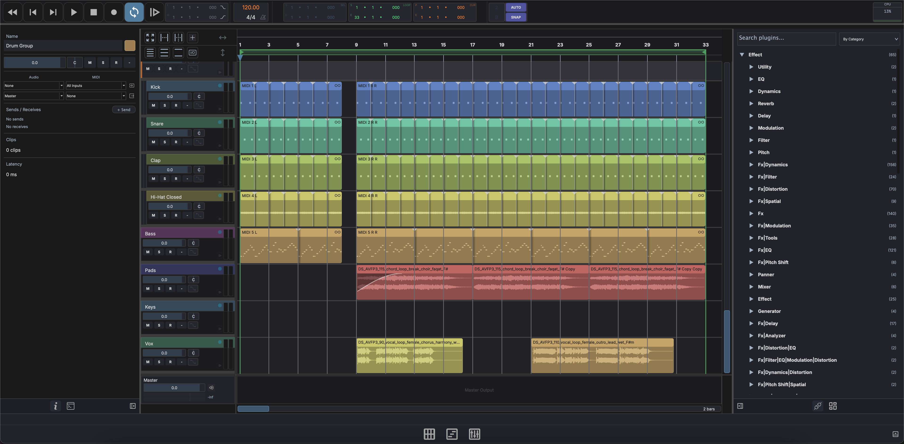
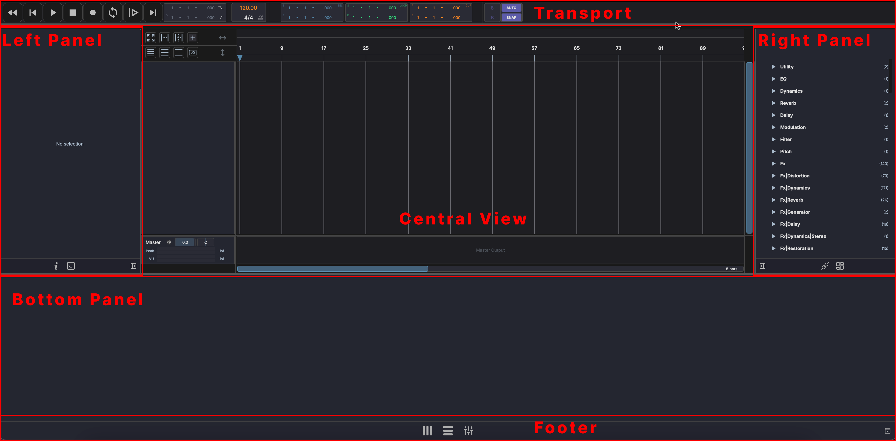

# Interface Overview

MAGDA's window is divided into fixed regions that stay consistent across all three views (Live, Arrange, Mix).

## Window Layout

## Transport Bar

The transport bar is the single row at the top of the window, and is always visible. It holds the playback controls, tempo and time signature, loop and punch, and the position displays. See [Transport](../transport.md) for details.

## Left Panel

The left panel has two tabs:

- **Inspector** — Context-sensitive properties for the selected track, clip, note, or device. See [Inspector](../panels/inspector.md).
- **AI Chat** — Chat-based assistant for natural-language control. See [AI Assistant](../panels/ai-assistant.md).

## Central View

The central area displays one of three views depending on the active mode:

- { width="18" } **Session View** — Grid-based clip launcher for real-time performance. See [Session View](../session-view.md).
- { width="18" } **Arrangement View** — Traditional timeline for composing and editing. See [Arrangement View](../arrangement-view.md).
- { width="18" } **Mixer View** — Channel-strip mixer for balancing and routing. See [Mixer View](../mixer-view.md).

Switch between views with the mode buttons in the footer, with ++f1++ / ++f2++ / ++f3++, or step through them with ++tab++ and ++shift+tab++.

In the Arrangement, the corner above the track headers holds the edit-tool button, the add-track button, and the zoom buttons. See [Arrangement View](../arrangement-view.md).

## Right Panel

The right panel has two tabs:

- **Plugins** — Browse, search, and drag plugins onto tracks
- **Samples** — Browse the file system and the media library, preview audio files, and drag them into the project

See [Plugin & Media Browser](../panels/browsers.md) for details.

## Bottom Panel

The bottom panel switches to match the selection:

- **Empty** — Nothing selected
- **Piano Roll** — When a MIDI clip is selected
- **Drum Grid** — When a MIDI clip is selected on a track whose instrument opens in the Drum Grid, or when you pick the Drum Grid tab for a MIDI clip
- **Chord editor** — When a clip on the chord track is selected
- **Waveform Editor** — When an audio clip is selected
- **Automation clip editor** — When an automation clip, or a point inside one, is selected
- **Track Chain** — When a track is selected, showing its FX chain

See [Editors](../panels/editors.md) for details. ++cmd+shift+p++ (++ctrl+shift+p++) expands the piano roll to fill the window below the transport, and again to return.

## Footer

The footer bar at the bottom of the window contains, from left to right:

- **Info line** — Names the control under the mouse with its help text. For a control that runs a command, such as the transport and view buttons, it also shows the command's name and its shortcut. Turn it off with **Show info line in the footer** in [Settings > General](preferences.md#behavior).
- **Live** / **Arrange** / **Mix** mode buttons — Switch between the three main views.
- **Ableton Link** — While [Ableton Link](connections.md#ableton-link) is on, a pill with the number of peers. Click it to open its settings.
- **Controllers** — A pill for each controller that is switched on, or for the loaded Lua script, with a green dot while its MIDI input is connected. Click one to open [Settings > Controllers](controllers.md).
- **Local models** — Icons for the local LLM and the Sample Analyzer. The tooltip names each one's state, and clicking opens [Settings > AI](ai-settings.md#local-models).
- **Bottom panel** — Shows or hides the bottom panel.

## Panel Behavior

The left and right panels have their tabs, drawn as icons, along the bottom edge, with a button to collapse the panel beside them. Double-click a collapsed side panel to open it again. The bottom panel is shown and hidden from the footer.

Drag a panel's edge to resize it. Side panels are at least 200 pixels wide. The bottom panel can't be dragged shorter than the instrument it shows needs; when it is already shorter, the device chain scrolls instead of squeezing the instrument. Double-click the bottom panel's header to size it to suit the instrument.

### Panel focus

Click into the arrangement (or the Session or Mixer view), the bottom panel, the browser or the inspector, and that region takes keyboard focus. A thin accent outline shows which one has it.

**Select All** (++cmd+a++ / ++ctrl+a++) follows the outlined region: in the arrangement it selects all clips, and in the bottom panel all notes of the edited clip. In the browser and the inspector it leaves clips alone, so text fields keep their own Select All. Delete, cut, copy and paste act on the selection, whichever region has focus.
