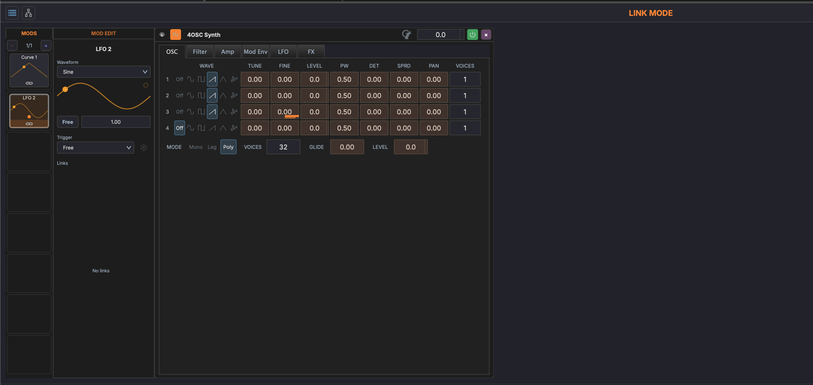
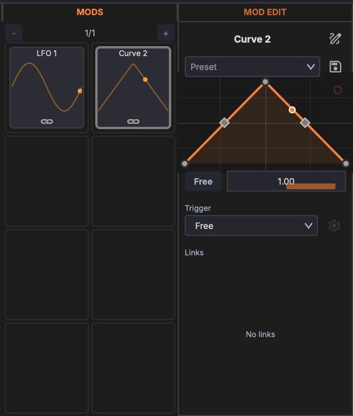

# Linking Parameters

Linking connects modulation sources (modulators or macros) to target parameters on devices.

## Link Mode

Link mode is the workflow for creating modulation connections:

1. **Enter link mode** — Click the link button in the corner of a modulator's or macro's card. **LINK MODE** shows in the track chain header while it is on
2. **Click a target** — Click any device parameter in the source's scope. MAGDA links it at 30% and shows a slider over the parameter
3. **Adjust the link** — Drag the slider to set the amount (0–100%). Clicking a parameter that is already linked shows the slider at its current amount
4. **Exit link mode** — Press ++escape++ or click the link button again

## Drag and Drop

You can also create links by dragging a modulator's or macro's card directly onto a target parameter. This is a shortcut that skips the link-mode workflow.

## Link Settings

Each link has the following properties:

- **Amount** — How much the source affects the target. A modulator's link can be negative, from −100% to +100%
- **Bipolar** — When enabled, modulation swings both above and below the parameter's current value. When disabled, modulation only adds to the current value
- **On** / **Off** — A modulator's link can be switched off without removing it

Edit a source's links on the **Links** tab of its [modulator editor](modulators.md#the-modulator-editor), or in the macro editor. To see everything driving one parameter, hover over it and hold ++alt++: a popover lists each link with its source, an amount you can drag, a **BI** / **UNI** switch, and a button that removes the link.

## Visual Indicators

When modulation is active:

- Outside link mode, a bar under each linked parameter shows the modulation moving in real time
- In link mode, the bar shows the link amount for the source you are linking instead
- The source's link button stays lit while its link mode is on

## Linking Modulator-to-Modulator

Modulators can target each other's **Rate** to create more interesting motion than a single LFO can produce on its own. A slow LFO modulating a faster LFO's rate gives you accelerating-then-decelerating wobbles; a square-wave LFO driving another LFO's rate gives you discrete tempo shifts.

To create the link:

1. Right-click the source modulator's card and pick the destination from **Link to Parameter... → Modulators → Rate**, or
2. Use link mode with the source modulator and click the destination's Rate field in its editor.
3. Adjust the modulation amount as usual.

A modulator's Rate can be driven by **modulators and macros from the same scope** (track, rack, or device). Cross-scope links — say, a track-level macro driving a Rate inside a nested rack — are not supported.

## Same-Scope Rule

Macro→param, macro→mod, mod→param, and mod→mod links must all stay within the same scope. The scope is the parent that owns the source: track-level macros target track-level mods or any device on the track; rack-level macros target rack-level mods or devices in that rack; device-level macros and mods target only that device.
