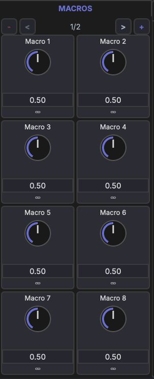
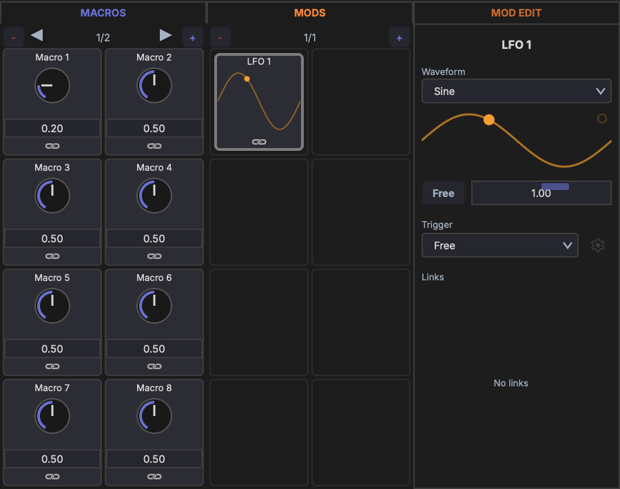

# Macros

Macros are user-defined control knobs that provide quick, unified access to multiple device parameters.

## Layout

Each track, rack, and device has **16 macro knobs** organized across **2 pages** (8 knobs per page). Page through them with the arrows in the macro panel's header; click **+** there to add another page, and right-click the header to **Remove last page**.

Open a track's macros with the **Track macros** button in the track chain header, or a rack's or device's with the **Macros** button in its header. Macros also appear in the [Inspector](../panels/inspector.md#mods-and-macros) when the track, rack, or device is selected.

Drag a macro's knob up or down to change its value; hold ++shift++ for finer steps. Click a macro without dragging to open the macro editor beside the panel, and click it again to close the editor. The editor shows the macro's name, its **Value**, and a list of its **Links**: drag across a link's row to change its amount, click **Bi** / **Un** to switch it between bipolar and unipolar, and click **x** to remove it.

## Range

All macro knobs output a normalized **0–1 range**. The mapping to each target parameter's actual range is handled by the modulation link (see [Linking Parameters](linking.md)).

## Naming

- Right-click a macro and choose **Rename** to give it a name (e.g., "Filter Cutoff", "Drive Amount").
- You can also double-click the name at the top of the macro editor.
- A macro's card shows its knob, its value, and how many links it has, but not its name; the name field appears on the card only while you rename it. The macro editor shows the name.

## Assigning Parameters

To connect a macro to a parameter:

1. Click the link button in the macro's corner to enter link mode (see [Linking Parameters](linking.md))
2. Click the target parameter
3. Set the link amount on the slider that appears over the parameter

Or right-click the macro and pick a parameter from the **Link to Parameter...** submenus, grouped by device. You can also drag the macro onto a parameter.

A single macro can control multiple parameters simultaneously — for example, one "Brightness" knob could increase filter cutoff, reduce reverb wet, and boost high-shelf EQ gain at the same time.

The macro's right-click menu also has **Show Automation Lane**, **Unlink** for each of its links, **Clear All Links**, and **Learn MIDI** to map a hardware control to it.

## Driving Modulators

A macro can also target a modulator's **Rate** instead of a device parameter — turn the macro and you turn the LFO speed. Same workflow:

1. Right-click the macro and pick the modulator from **Link to Parameter... → Modulators**, or
2. Use link mode and click the modulator's Rate slider as the target.

In the screenshot, **Macro 1** at 0.20 is dialling **LFO 1**'s Rate down. As the macro turns, the LFO speed follows. Combine with traditional parameter links and a single knob can sweep filter cutoff, reduce reverb send, *and* slow the LFO that's wobbling the pitch — all at once.

On a rack, a macro can also drive the rack's **Chain Select** control, listed in the same menu.

## Use Cases

- Map the most important synth parameters to a few knobs for live performance
- Create unified controls that coordinate multiple effects at once
- Expose simple controls for complex multi-device setups
- Use a macro as a "tempo" or "intensity" control that drives an LFO's rate alongside the parameters it modulates
