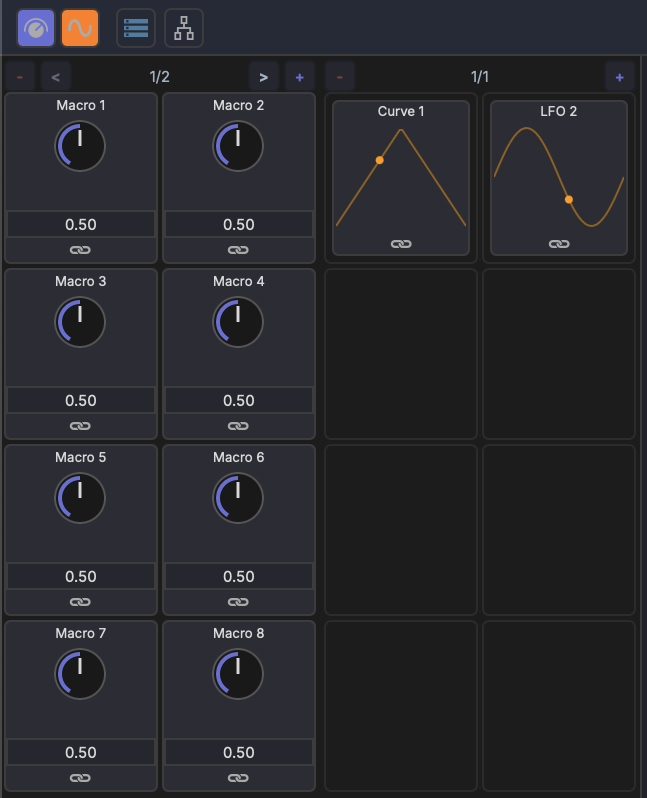
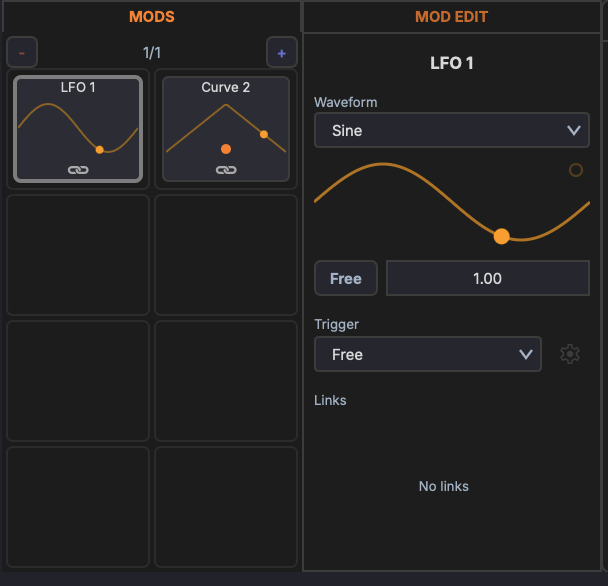
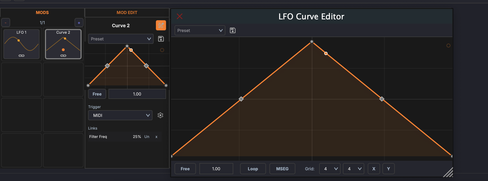
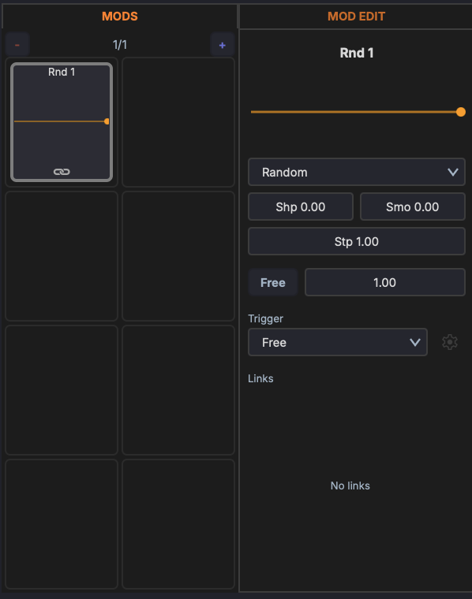
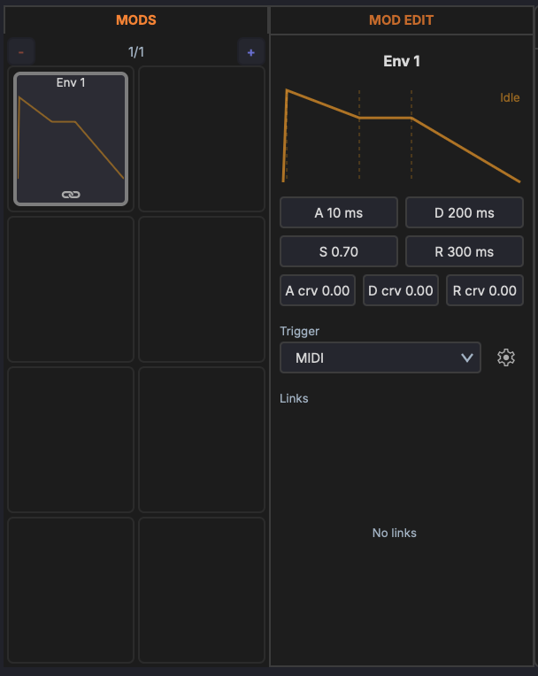
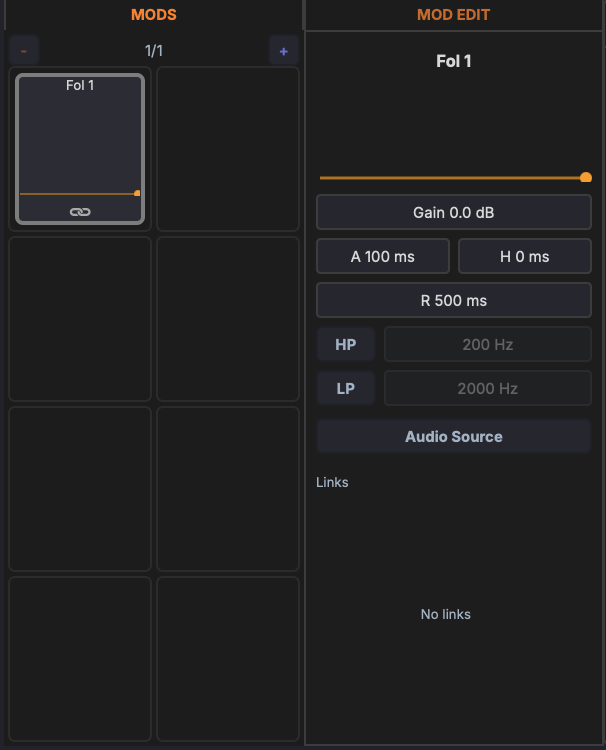

# Modulators

Modulators are signal generators that modulate device parameters over time. A track's modulators can target any parameter on any device in the track's chain; racks and devices have modulators of their own too (see [Hierarchical Scope](overview.md#hierarchical-scope)).

Open a track's modulators with the **Track modulators** button in the track chain header, or a rack's or device's with the **Mods** button in its header. They also appear in the [Inspector](../panels/inspector.md#mods-and-macros). Click **+ Add mod** in the next free slot and pick **LFO**, **Curve**, **Envelope**, **Random**, or **Follower**. Modulators fill the slots in order; click **+** in the panel's header to add another page of slots, and right-click the header to **Remove last page**.

{ width="500" }

Each card shows the modulator's shape, a short type tag (such as SINE, ADSR, S&H, or FOL), its rate or time, and how many links it has. The name appears on the card only while you rename it.

Right-click a modulator's card for **Rename**, **Show Automation Lane**, **Disable** / **Enable**, the **Link to Parameter...** submenus, **Unlink** for each of its links, **Clear All Links**, **Learn MIDI** (which maps a controller to the modulator's rate), and **Remove**. Custom names such as "Filter Wobble" or "Swell" make a track with several LFOs and envelopes far easier to read.

## The Modulator Editor

Click a modulator's card to open its editor beside the panel; click the card again to close it. The editor has two tabs at the top:

- **The modulator's name** — the first tab, over the modulator's controls. Double-click the name to rename it.
- **Links** — how many parameters the modulator drives, over a list of its links. Each row shows the target parameter, the link amount (drag across the row to change it, from −100% to +100%), **BI** / **UN** for bipolar or unipolar, **ON** / **OFF**, and **x** to remove the link.

Every modulator except the follower ends on its **TRIG** row: **Free** (runs continuously), **Transport** (restarts when playback starts), **MIDI** (restarts on incoming notes), or **Audio** (restarts on incoming audio). For **MIDI** and **Audio** on a device or rack modulator, the settings button beside it picks what triggers it: the track itself or another track.

The LFO, Curve, and Random modulators share a rate row: the **Free** / **Sync** button switches between a rate in Hz and a tempo-synced division (such as 1 Bar, 1/4, or 1/8), and the field beside it sets the value.

## LFO

A low-frequency oscillator that cycles through a waveform shape. Pick the shape from the row of icons at the top:

- Sine
- Triangle
- Square
- Saw Up
- Saw Down

Below the shape display sit the rate row and the trigger. With the **Audio** trigger, **Atk** and **Rel** set how the trigger follows the incoming level.

## Curve

A freely editable modulation shape. Use it to create complex, custom modulation patterns that go beyond standard waveforms.

The row at the top holds a **Preset** menu of starting shapes (Triangle, Sine, Ramp Up, Ramp Down, S-Curve, Exp, Log) and a button that opens the curve in its own, larger editor window. Below the curve sit the rate row and the trigger.

### Editing

- **Add a point** — Double-click an empty spot on the curve
- **Move a point** — Drag it to a new position
- **Adjust curvature** — Drag the handle between two points to bend that segment; double-click the handle to straighten it
- **Delete a point** — Double-click an existing point

The editor window adds a **Loop** / **1-Shot** switch, so the curve can play once instead of looping, along with grid and snap settings and buttons to save the curve as a preset or reset it.

## Random

A randomised modulation source with its own shaping and smoothing controls. It runs as stepped random values or as continuous noise.

### Type

The **Random** / **Noise** switch at the top selects the source:

- **Random** — Generates a new random value each cycle (sample & hold)
- **Noise** — Continuous random signal

### Parameters

- **Shp** (Shape) — Biases the distribution of the random values
- **Smo** (Smooth) — Smooths the transitions between values (0 = hard steps, 1 = gliding)
- **Stp** (Step Depth) — Amount of stepped variation between values
- **Rate** — The rate row sets the speed, free-running or tempo-synced
- **TRIG** — How the modulator is (re)started

## Envelope (ADSR)

An ADSR envelope used as a modulation source. Triggered by playback or incoming MIDI notes, it shapes a parameter through attack, decay, sustain, and release stages. The display at the top shows the envelope shape and its current state.

### Parameters

- **A** (Attack) — Rise time to peak (ms)
- **D** (Decay) — Fall time to the sustain level (ms)
- **S** (Sustain) — Held level while gated (0–1)
- **R** (Release) — Fall time after the gate releases (ms)
- **A crv / D crv / R crv** — Bend each stage from logarithmic to exponential
- **TRIG** — What starts the envelope: **Free** (cycles continuously), **Transport** (starts on play), **MIDI** (gated by note on/off), or **Audio**

## Envelope Follower

Follows the amplitude of an audio signal and uses it as a modulation source. Use it to make one parameter react to the dynamics of a track, for example ducking a pad from a kick drum. The display at the top shows the live follower output.

### Parameters

- **Gain** — Input gain into the detector (dB)
- **A** (Attack) — How fast the follower rises
- **H** (Hold) — Time held at the peak before releasing
- **R** (Release) — How fast the follower falls

Times from one second up read in seconds.

### Detection filters

Band-limit what the follower reacts to so it tracks only part of the spectrum:

- **HP** — Toggle on and set the cutoff to ignore low frequencies
- **LP** — Toggle on and set the cutoff to ignore high frequencies

Cutoffs from 1 kHz up read in kHz.

### Audio source

Click the **Audio Source** button at the bottom to choose what the follower listens to — the track's own audio, or another track's audio routed in as a sidechain.
