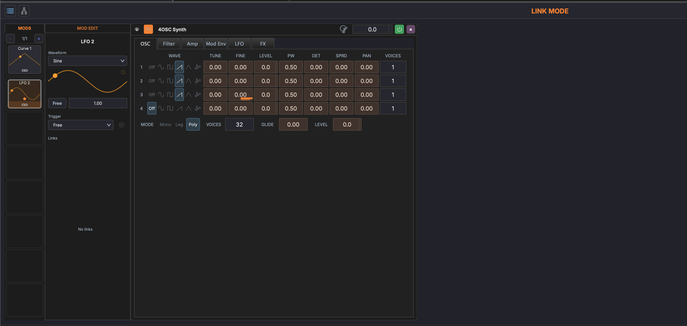
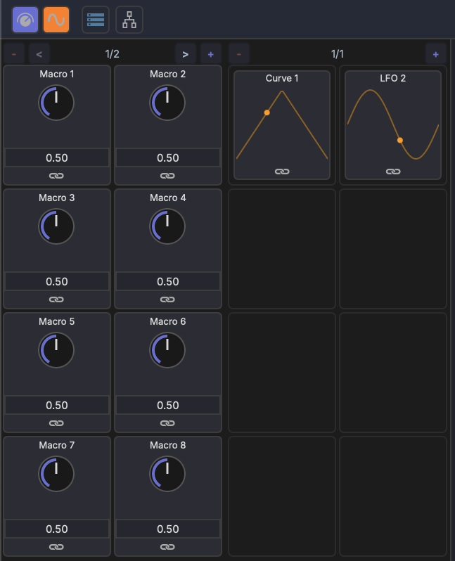
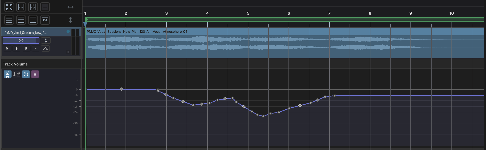

# Modulation Overview

MAGDA provides two complementary modulation systems: **Modulators** and **Macros**. Both allow you to dynamically control device parameters without manual automation.

## Modulators

Modulators are signal generators that continuously vary a target parameter over time. MAGDA includes:

- **LFO** — Low-frequency oscillator with sine, triangle, square, and saw shapes
- **Curve** — A freely editable shape for complex custom patterns
- **Envelope** — An ADSR envelope
- **Random** — Stepped random values or continuous noise
- **Follower** — Follows the level of an audio signal

See [Modulators](modulators.md) for details.

## Macros

Macros are user-defined knobs that can control multiple parameters at once. Each track, rack, and device has 16 macro knobs (across 2 pages) that provide quick access to the most important parameters.

See [Macros](macros.md) for details.

## Hierarchical Scope

Modulators and macros live at three levels: on a **track**, on a **rack**, or on a single **device**. Each scope reaches only the parameters it owns — a track's modulators and macros can target the devices in that track's chain, but not parameters on other tracks. See [Same-Scope Rule](linking.md#same-scope-rule).

## Multi-Target and Multi-Source

- A single modulator can drive **multiple target parameters** simultaneously
- A single parameter can be driven by **multiple modulation sources**, with their effects combined

## Track Modulator & Macro Panels

{ width="400" }

The **Track macros** and **Track modulators** buttons in the [track chain](../panels/track-chain.md) header open the track's macro and modulator panels at the start of the chain: macros first, then modulators, each followed by its editor when you click a card. Racks and devices have the same two panels, opened from the **Macros** and **Mods** buttons in their own headers. Each panel shows its cards on pages of eight, with arrows to page through them.

The same panels appear in the [Inspector](../panels/inspector.md#mods-and-macros) when a track, rack, or device is selected, so you can edit modulation from either place.

## Internal Device Modulation

Some built-in devices have their own internal modulation routing that operates inside the device's audio processing.

Internal modulation and track-level modulation are independent and can be used together.

## Linking

Parameters are connected to modulation sources using MAGDA's link mode. See [Linking Parameters](linking.md) for the workflow.

## Automation Lanes

In addition to modulators and macros, any parameter can be automated with a drawn curve on an automation lane below the track in the [Arrangement View](../arrangement-view.md). Automation lanes play back their drawn curves during transport — the parameter follows the lane's value over time, in sync with playback.

Automation is independent of modulators and macros: all three can drive the same parameter at once, with their effects combined.
