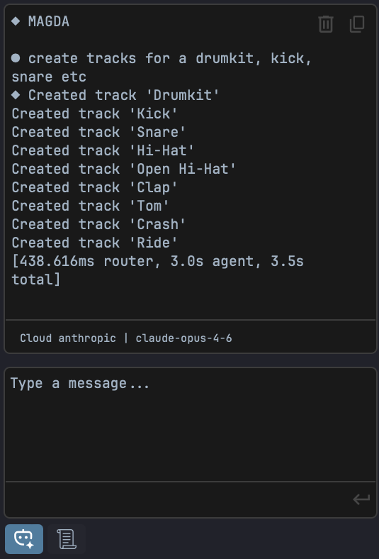
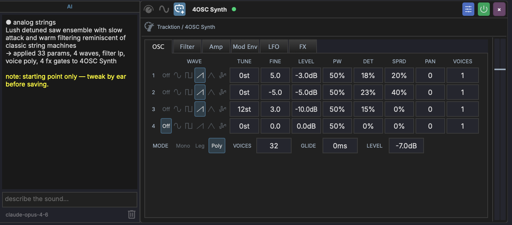

# AI Assistant

MAGDA includes a built-in AI chat assistant that lets you control the DAW using natural language. The same console runs [DSL](../reference/dsl.md) code directly with the `/dsl` command.

{ width="400" }

## Overview

The AI Assistant is the **AI Chat** tab of the left panel. From top to bottom it has:

- **Header** — the MAGDA mark, a **model chip**, and the **Clear chat** and **Copy chat to clipboard** buttons. The chip names the current AI setup and model, with a dot that turns green while a model is ready; click it to open [Settings > AI](../interface/ai-settings.md). With the embedded local model, a button beside the chip loads or unloads it.
- **Conversation** — your messages appear as bubbles labelled `YOU → <target>`, with MAGDA's replies under a **MAGDA** label. Copy takes the whole conversation; Clear empties it and resets the assistant's memory of every view.
- **Prompt box** — where you type. ++enter++ sends, ++shift+enter++ adds a line.
- **Controls row** — under the prompt: the **target chip** (see [Selection Context](#selection-context)), key hints for ++shift+enter++, `@` and `/`, and the send button. The send button lights once there is something to send, and turns into a stop button while a request runs: click it to cancel.

## Making Requests

Type a request in natural language and the assistant translates it into actions:

- "Add a MIDI track with a bass clip"
- "Transpose the selected notes up an octave"
- "Set the tempo to 120 BPM"
- "Mute tracks 3 and 4"

The assistant is **context-aware** — it knows which tracks, clips, and devices exist in your project and what is currently selected.

### Selection Context

The target chip under the prompt shows what your next request is aimed at: a coloured square, the word *on*, and the target, such as `on Bass`, `on Bass > Verse` or `on Bass > Poly Synth`. The square takes the target track's colour. The square and the label do different jobs.

**The square** controls whether your current selection is sent at all. When it is on, the AI treats the selected track, clip, or device as the default target — a request like "add a bassline" with a track selected targets that track instead of creating a new one. Click it to turn it off, and requests are interpreted without a default target; the chip dims while it is off.

Creating a new track still works either way — just be explicit in the request ("new track", "another track") when the selection context is on.

**The label** opens a picker for attaching MIDI clips explicitly. It reads *Add MIDI context* when nothing is selected or attached. Once clips are attached it summarises them instead of the selection (`Bass > Verse`, `Bass · all MIDI`, `6 MIDI · 3 tracks`).

### MIDI Context

Attaching MIDI sends the actual notes to the model, so it can answer about what you have written rather than guessing. Useful for "harmonise this", "write a counter-melody to these two parts", or "make the bass follow the chords in the piano clip".

Click the target chip's label to open the picker:

- **Use selection** — attach the selected MIDI clips, or every MIDI clip on the selected tracks.
- **Clear** — detach everything.
- The list below shows each track with its MIDI clips indented underneath. Tick a clip to attach it, or a track to attach all of its clips. A track shows a dash instead of a checkmark when only some of its clips are attached.

Attaching context turns the selection context back on. Audio clips cannot be attached — only MIDI. Clips deleted after being attached drop out of the set on their own.

!!! note "Bounded on purpose"
    However much you tick, MAGDA sends at most 16 clips, 128 notes per clip, and 256 notes in total, plus up to 32 chord annotations per clip. Selecting an entire project therefore cannot exhaust the model's context window — but it does mean a very large selection is sent in part rather than in full. Attach the clips that matter.

### How It Works

1. You type a natural-language request in the chat
2. The assistant translates your request into MAGDA's internal DSL (domain-specific language)
3. The DSL commands are executed as actions in the project
4. The assistant confirms what was done

### Setup

The AI Assistant supports both cloud LLM providers and a fully offline local model. Configure them under **Settings > AI**: choose providers on the **Assistant** tab, add API keys on the **Providers** tab, and set up the embedded model on the **Local models** tab. See [AI](../interface/ai-settings.md).

### Usage Tips

- Be specific: "Add a reverb to Track 2" works better than "make it sound spacey"
- The assistant can handle multi-step requests: "Create 4 MIDI tracks and name them Kick, Snare, HiHat, Bass"
- Use it for repetitive tasks: "Set all tracks to -6 dB"
- Prefix a message with `/dsl` to execute DSL directly from the AI chat without making an AI call

## Drummer Agent

When you select a track whose [Drum Grid](../devices/drum-grid.md) has at least one row with a [role](drum-grid-editor.md#row-labels-and-roles), or a MIDI clip on such a track, the AI chat automatically switches into **Drummer** mode. The target chip reads `Drummer · <track name>`, and your requests are routed to a specialised agent that writes drum patterns instead of the general DAW assistant.

In this mode, describe the groove you want in plain language:

- "four on the floor with offbeat open hats"
- "a half-time hip-hop beat, snare on 3"
- "busier hats in the second bar"

The agent works in terms of drum **roles** (kick, snare, closed hat, and so on), so it places hits on the pads you have labelled with matching roles. If a Drum Grid clip is selected, its current pattern is sent along as context, so follow-up requests like "add a crash on the downbeat" build on what is already there. The generated pattern is written straight into the selected clip.

Drummer mode is automatic and context-driven; there is no slash command to type. Select a non-drum track to return to the general assistant. To send a single request to the drummer from anywhere else, use [`/agent drummer`](#agent-override-routing).

## View Context

The console follows the view you are working in:

- **Arrangement view** — requests go to the arrangement agent: tracks, clips, devices, composition and project timing.
- **Session view** — there is no session agent yet, so a request sent from here gets a reply saying it isn't available. Use [`/agent`](#agent-override-routing) to send it to another agent.
- **Mixer and master views** — requests are routed to the **mixing agent**.

What you have selected narrows this. With notes selected, a request goes to the piano-roll agent; with an automation lane, clip or point selected, to the automation agent; and with a device selected, to the device agent. A Drum Grid track or clip goes to the [Drummer Agent](#drummer-agent).

Each view keeps its own conversation, so switching between Arrangement, Session, and Mixer picks up the thread you left in that view rather than mixing them together.

## Mixing Agent

In the mixer view, the console talks to a specialised mixing agent. It can read the per-track measurement layer — loudness, peaks, stereo width and correlation, and detected frequency collisions between tracks — and ground its feedback in those numbers.

Run an analysis from the mixer's [Analyze button](../mixer-view.md#mix-analysis) first; a **mix analysis ready** chip appears beside the send button once results exist. Then ask things like:

- "what is fighting with the bass?"
- "is the master loud enough for streaming?"
- "which tracks are mono-incompatible?"

The agent reads the measured findings rather than guessing from track names, and can suggest concrete moves (level trims, EQ areas to look at) based on them.

## Running DSL Directly

The `/dsl` command runs [MAGDA DSL](../reference/dsl.md) code against the project with no AI call and no network access. Type `/dsl` followed by the code and press ++enter++:

```
/dsl track(name="Bass", new=true).clip.new(bar=1, length_bars=4)
```

Press ++shift+enter++ to put a longer script on several lines. The reply lists what each statement did, or **OK** when there is nothing to report; a failing statement is reported as an error. Type `/dsl` on its own, or `/dsl --help`, for a cheat sheet of common commands, and `/dsl --examples` for ready-made lines.

## DSL Quick Reference

A few common commands to get started. For the full language reference, see **[DSL Reference](../reference/dsl.md)**.

```
track(name="Bass", new=true).clip.new(bar=1, length_bars=4)
  .notes.add_chord(root=C4, quality=major, beat=0, length=4)
  .notes.add(pitch=E2, beat=0, length=1, velocity=100)
track(name="Bass").fx.add(name="compressor")
track(name="Bass").track.set(volume_db=-6)
groove.set(template="Basic 8th Swing", strength=0.5)
```

## Slash Commands

Prefix your message with a slash command to run a tool directly or constrain the AI to a specific domain:

| Command | Description |
|---------|-------------|
| `/groove <request>` | Create, extract or apply grooves (see [below](#groove-grooves)) |
| `/theme <description>` | Generate a UI colour theme from a natural-language description and apply it live |
| `/controller <description>` | Generate a hardware [controller profile](../interface/controllers.md) from a description of the surface |
| `/agent <surface> <request>` | Send one request to a specific agent, overriding the view's usual routing |
| `/dsl <code>` | Execute [DSL](../reference/dsl.md) directly, with no AI call |

Typing `/` shows an autocomplete popup with available commands. Run a command with `--help`, or on its own, for its in-app cheat sheet, and with `--examples` for example prompts.

### `/agent` — Override Routing

Requests are normally routed by the view you are in (see [View Context](#view-context)). `/agent` overrides that for a single message when you want a different specialist:

```
/agent drummer busier hats in bar 2
/agent mixer tame the low mids on the bass
```

Available surfaces: `arrangement`, `piano-roll`, `session`, `mixer`, `automation`, `device`, `master`, `drummer`.

### `/groove` — Grooves

`/groove` keeps the AI to groove operations: creating a groove, extracting one from an audio clip, applying one, or listing them. It never writes notes or clips.

```
/groove make a shuffled 16th-note groove with subtle delay on the off-beats
/groove extract the timing feel from the selected clip into a new groove
```

Grooves play as [time bends](../time-bend.md#grooves). Applying one loads its curve into the selected MIDI clip's time bend, and the strength you ask for becomes the bend's **AMOUNT**. Grooves you create appear under **Custom** in the **GROOVE** menu.

### `/theme` - AI Theme Generator

Type `/theme <description>` to design a MAGDA colour theme from words - for example `warm sunset, dark`, `cold arctic blue`, `retro amber terminal`, or `cyberpunk neon on black`. The assistant produces a full palette, saves it as an editable JSON file in `Documents/MAGDA/Themes`, selects it, and applies it live.

Generated themes also carry a complete `syntaxColours` section, so the code editor and the AI console match the rest of the palette. Any syntax role the assistant does not design is derived from the palette it just produced.

The theme stays selected afterwards. Edit its `.json` on disk to tweak it - changes re-apply instantly - or switch themes at any time under **Settings > Appearance**. See [Settings - Theme](../interface/preferences.md#theme) for the theme file format and the **Get template** and **Load theme** buttons.

Which model powers `/theme` is set by the **Theme** row of the [Advanced setup](../interface/ai-settings.md#advanced-setup) on **Settings > AI > Assistant**.

## Per-Device AI Panel

Sound design happens in the device chain. Every device with an AI agent behind it shows an **AI** icon in its header — click it to open a docked panel attached to that device.



The panel has three rows:

- **Output area** — streams the model's response token-by-token. On success the raw result is replaced by the preset's description, followed by a one-line apply status (`→ applied 14 params to Poly Synth`) and a yellow reminder that the result is a starting point to tweak by ear. The history persists across slot rebuilds (preset loads, plugin reloads, sidechain edits) — your last result stays put until you clear it.
- **Prompt input** — type a description and press ++enter++ to submit. Submitting cancels any in-flight generation on the same device.
- **Footer** — the active model on the left; on the right a stop button while a generation runs, and **Clear chat**, which clears the panel for that device only.

Generations are scoped to the device the panel is mounted on. The preset name the AI chose becomes the default name when you next save a preset from the device header — just click save and hit Enter.

On a [Faust](../devices/effects.md#faust-custom-dsp) device the panel writes DSP code, and a strip at its top shows whether the Faust checker is off, on or connected (see [Tools](../interface/ai-settings.md#tools)). With the checker on, code that passes it is loaded and marked *compilation verified*. With it off, the code is put in the device's editor for you to compile. The Faust panel keeps the conversation, so a follow-up request revises the last code; **Clear chat** starts it afresh.

### Which devices can be designed

| Device | What the agent writes |
|--------|-----------------------|
| **MAGDA sound generators** — [Poly Synth](../devices/poly-synth.md), [FM0](../devices/fm0.md), the [Drum Kit](../devices/drum-kit.md) voices (Kick, Snare, Hat, Tom, Clap), the [Physical Models](../devices/physical-models.md) (Marimba, Djembe, Bell), and the [Mutable Instruments ports](../devices/mutable.md) Materia and Halo | Any of the device's own parameters |
| **[Step Sequencer](../devices/step-sequencer.md)** and **[Poly Sequencer](../devices/poly-sequencer.md)** | A pattern rather than a preset |
| **[Faust](../devices/effects.md#faust-custom-dsp)** and **[Faust Instrument](../devices/faust-instrument.md)** | DSP code — the prompt reads *describe an effect or instrument...* |
| **Third-party plugins** | The parameters you nominate — see [below](#ai-sound-design-for-third-party-plugins) |

Beyond the sequencers, which keep purpose-written agents, sound design works by **parameter introspection**: the agent reads the device's parameters at runtime — names, units, real-world ranges, and discrete choices — and asks the model for values in those real units (Hz, ms, dB, semitones) rather than in normalised 0–1 terms. That is why it generalises across devices without per-device tuning.

The [Sampler](../devices/sampler.md), [Drum Grid](../devices/drum-grid.md), and effects devices have no sound-design agent.

To hide the AI icon on a sound generator or plugin you would rather drive by hand, right-click it in the [Plugin Browser](browsers.md#plugin-browser) and untick **AI Sound Designer**. The setting is per device and persists.

### AI sound design for third-party plugins

Third-party plugins can be designed too, but not automatically: a plugin exposing hundreds of opaque parameters gives the model nothing useful to work with. You choose what it is allowed to touch.

1. Right-click the plugin in the [Plugin Browser](browsers.md#plugin-browser) and choose **Configure AI Sound Designer...** (or **Configure Parameters...**, which opens the same dialog).
2. Tick the **AI Agent** column for each parameter the designer should be able to set. This column is separate from **Visible** — a parameter can be hidden in the chain and still be available to the AI, or the other way round.
3. Optionally click **AI Prompt...** to add standing instructions for this plugin — how its oscillator sections are laid out, which parameters interact, anything the parameter names alone do not convey. The button gains a checkmark once a prompt is saved, and the text is prepended to every design request for that plugin.
4. Set units and ranges for the nominated parameters, either by hand or with **Detect** / **AI Detect**. The better the ranges, the more usable the generated values. See [Plugin Parameters](../plugin-parameters.md).

The **AI** icon appears on the device slot once at least one parameter is ticked.

## Plugin and Parameter Aliases (`@`)

The AI chat understands **`@aliases`** as a shorthand for plugins. Type `@` in the chat input to open an autocomplete list of every MAGDA device and installed plugin by its alias, such as `@serum_2`. Type a `.` after a plugin alias to list that plugin's parameter aliases, such as `@eq.low_shelf_freq`. Use the arrow keys to move through the list, and ++enter++ or ++tab++ to insert the entry.

Aliases tie a request to one specific plugin without spelling out its full name:

```
add @serum_2 to the Lead track
```

An alias is passed on as the plugin's [alias token](../reference/dsl.md#effects), so the DSL resolves it to the same plugin. To change a plugin's alias, right-click it in the [Plugin Browser](browsers.md#plugin-browser) and choose **Edit Alias...**.
