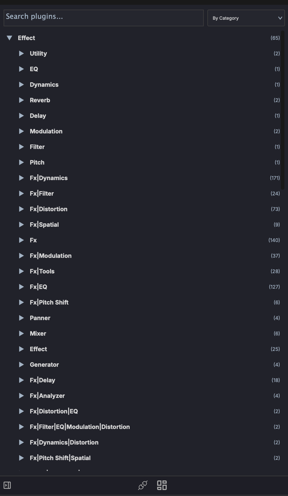
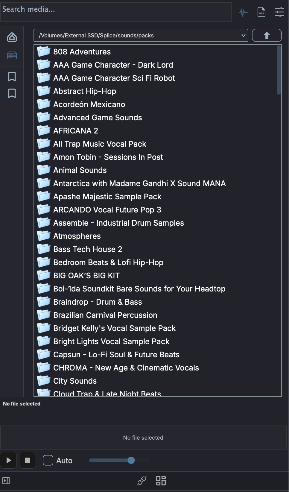

# Plugin & Media Browser

The left panel contains two browser tools for finding and adding content to your project.

The two browsers share one search term. Type in either and the other follows, and the term stays when you switch tabs. ++cmd+f++ (++ctrl+f++ on Windows/Linux) puts the cursor in the search field.

## Plugin Browser

The Plugin Browser shows all available audio plugins organized in a tree view.

### Navigation

- **View** — Choose how the tree is organised: **By Category**, **By Manufacturer**, **By Format**, **Favorites** or **Folders**
- **Search plugins** — Type to filter by plugin name. The filter stays applied when the list refreshes after a scan
- **Favorites** — Right-click a plugin and choose **Add to Favorites** for quick access in the Favorites view
- **Folders** - Switch to the Folders view and organize plugins into your own folders, from a plugin's right-click menu or by creating them with **New Folder...**. Folders stay in creation order and remain drop targets even when empty; an **Unfiled** bucket holds everything you have not filed.

### Adding Plugins

- **Drag and drop** — Drag a plugin from the browser onto a track header or into the FX chain to add it
- **Right-click** — Choose **Add to Selected Track** or **Add to Selected Chain**

The right-click menu also offers **Configure Parameters...** (see [Plugin Parameters](../plugin-parameters.md)), **Edit Alias...**, **Prefer Drum Grid**, **Treat as MIDI FX** and **Show in Finder**.

ARA plugins such as Melodyne are added the same way; see [ARA Plugins](../ara.md).

### Supported Formats

- VST3
- Audio Units (AU) — macOS only
- LV2

On macOS, when a plugin is installed as both VST3 and AU, the browser shows only your preferred format. See [Preferred plugin format](../interface/plugin-settings.md#preferred-plugin-format).

### Rescanning

If a newly installed plugin doesn't appear, rescan your plugin folders in **Settings > Plugins**. See [Plugin Settings](../interface/plugin-settings.md#scanning).

## Media Explorer

The Media Explorer lets you browse files on your system and preview audio before importing.

!!! tip "Searchable library"
    The same panel has a **Library** mode that indexes folders into a searchable database, so you can find sounds by family, key, tempo, tags, or a plain-language description. See [Media Library](media-library.md).

### Navigation

The sidebar on the left switches what the browser shows:

- **Project** — The current project's media folder
- **Disk** — Your file system
- **Library** — The indexed [Media Library](media-library.md)
- **Favourite folders** — Below the other buttons. Right-click a folder in the browser and choose **Add to favorites** to pin it there (up to eight). Right-click a favourite to **Remove from favorites** or **Set as default directory**

In Disk mode:

- **Path box** — Shows the current folder, with an up button beside it to go to the parent
- **List / Tree** — Show the folder as a flat list or as a directory tree
- **Search media** — Type to search the current folder and every folder inside it. Moving to another folder clears the search

### Preview

- Click an audio file to preview it through your monitor output
- Preview plays the file as it is on disk, at its own tempo and pitch, unless **Sync** is on (see below)
- With **Auto** on, ++arrowup++ / ++arrowdown++ step through results and audition each one as it is selected; ++arrowleft++ stops the preview and ++arrowright++ replays it from the start

The preview player sits under the file list. With **Wave** on it shows the file's name, a line of details (tempo, length, sample rate and bit depth), and its waveform. The controls below drive the preview:

- **Play** / **Stop** - start the selected file from the beginning, or stop it. Play is greyed out until a file is selected
- **Auto** - audition each file as soon as it is selected, instead of waiting for **Play**
- **Sync** - play loops at the project tempo without changing their pitch, following tempo changes while they play. It uses the tempo the [Media Library](media-library.md) holds for the file; a file with no tempo there plays unchanged
- **Wave** - show or hide the file name and waveform, giving their height to the file list. MAGDA remembers the choice
- **Volume** - preview level, in dB. It is independent of the project's mixer and is not recorded into anything

Preview runs outside the project's mixer and goes straight to the output pair you nominate, so it keeps working while the transport is stopped. Choose that pair with the **Preview** toggle in **Settings > Audio & MIDI** (see [Audio Settings](../interface/audio-settings.md#preview)).

### Filters

The file-type buttons beside the search field show or hide each kind of file:

- **Audio** files
- **MIDI** files
- **Presets** — MAGDA presets and sampler instruments (SFZ, DecentSampler)
- **Chord progressions**

### Importing

- **Drag and drop** — Drag files from the explorer onto a track or clip slot to import
- Supported audio formats: WAV, AIFF/AIF, FLAC, OGG, MP3 where a platform decoder is available
- Supported MIDI formats: .mid files

### Multi-Select

- ++shift++-click to extend the selection to a contiguous range
- ++cmd++-click (++ctrl++-click on Windows/Linux) to toggle individual files in and out of the selection
- Drag any file in the selection to drag the whole selection out

Drop targets vary by destination:

- [Arrangement View](../arrangement-view.md#multi-sample-drag-and-drop) — empty area creates one track per sample; existing track appends clips sequentially
- [Session View](../session-view.md#multi-sample-drag-and-drop) — empty area creates one track per sample stacked into scene rows; existing track stacks clips down consecutive scene slots
- [Drum Grid](../devices/drum-grid.md#multi-sample-drop) — samples fill consecutive pads from the drop target
