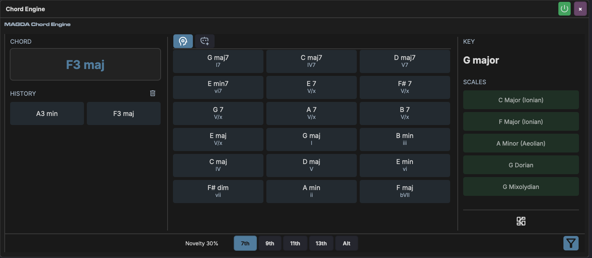
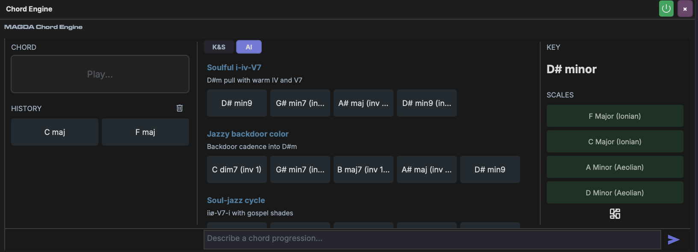

# Chord Panel

!!! note "Chord Engine device"
    The Chord Panel is the [Chord Engine](../devices/chord-engine.md) device's view, docked beside the clip editors. Everything it does is described in full on the Chord Engine page; this page covers where the panel appears and how it differs.

The Chord Panel is a real-time chord analysis and suggestion tool. It detects chords as you play, identifies the musical key, lists matching scales, and suggests what chord to play next.

## Where it appears

The panel opens on the right of the bottom panel when the clip you are editing is on a track with a Chord Engine:

- beside the [Piano Roll](piano-roll.md), for a MIDI clip on a track whose chain holds a Chord Engine;
- beside the chord editor, for a clip on the [chord track](../chord-track.md), which always has a Chord Engine.

It reads and drives that track's Chord Engine, so the chords it detects are the ones played on that track. Drag a suggestion straight onto the editor beside it to place the chord (see [Placing Chords](../devices/chord-engine.md#placing-chords)).

The collapse button in the panel's bottom-left corner (*Toggle chord panel*) folds it to a narrow strip at the right edge, and the same button on the strip brings it back. Drag the panel's left edge to make it wider or narrower; dragging it very narrow folds it, and double-clicking the edge toggles it too.

## Layout

The panel is divided into three columns:

| Column | Content |
|--------|---------|
| **Chord** (left) | The chord you are playing, with its degree in the detected key, then the **History** of recent chords |
| **Suggestions** (centre) | Suggestion tiles in two groups, **Diatonic** and **Beyond the key**, or the AI's progressions |
| **Key / Scales** (right) | Detected key, a button to browse scales, and the matching scales |

A footer spans the bottom with the controls that shape the suggestions. Unlike the device in a chain, the docked panel shows no keyboard under the chord name.

## Chord Detection

Play notes on the track and the panel displays the detected chord name in real time. Recent chords appear in the **History** section below; the bin button beside it clears the history and resets detection. See [Chord Detection](../devices/chord-engine.md#chord-detection).

## Key Detection

The detected key (e.g. "C minor") is shown at the top of the right column, found with the Krumhansl-Schmuckler key-finding algorithm. See [Key Detection](../devices/chord-engine.md#key-detection) for how it works.

!!! info "Why the detected key might not match any chord you played"
    The algorithm detects the *tonal centre* from the aggregate pitch content, not from specific chord names. For example, playing G minor and Bb major together contributes pitch classes (G, Bb, D, Bb, D, F) which can correlate strongly with C minor's profile — even though you never played a C minor chord. This is musically correct: G minor and Bb major are the v and VII chords of C minor.

## Scale Detection

Below the key, the panel lists the top matching scales, ranked by how well the pitch classes you've played match each scale's note set.

- **Click** a scale to see all diatonic chords built from it.
- **Shift-click** a scale to select it for filtering. You can select multiple scales — their pitch classes are merged and used to filter chord suggestions.

## Suggestions

The centre column shows chord suggestions ranked by musical relevance, in two groups: **Diatonic** (in key) and **Beyond the key** (secondary, borrowed and substitute chords). Each tile shows its Roman numeral degree. Press a tile, in the suggestions or the history, to hear it through the track's instrument. See [Suggestion Generation](../devices/chord-engine.md#suggestion-generation).

## Footer Controls

| Control | Description |
|---------|-------------|
| **Novelty** | Slider from *safe* to *wild*: the balance between diatonic (0%) and non-diatonic (100%) suggestions |
| **Extensions** | Toggles for the extensions the suggestions may use: **7th**, **9th**, **11th** and **13th**. **Alt** adds borrowed chords and tritone substitutes. |
| **Scale filter** | The funnel button: filter suggestions by the detected scales |

## Browse

The browse button beside the key (*Browse scales*) swaps the suggestions for a list of every scale, with root-note buttons to narrow it to one key. The back arrow (*Back to suggestions*) returns to the suggestions.

## AI Mode

Switch to the **AI** tab, with the icons at the top of the suggestions column, to generate chord progressions from text descriptions. Type a prompt describing the style or mood (e.g. "Soulful I-iv-V7", "Jazzy backdoor voicing") in the prompt at the foot of the panel and the AI returns labelled progressions as rows of chord buttons. Press a chord to audition it, or drag it onto the editor beside the panel.

See [Chord Engine — AI Tab](../devices/chord-engine.md#ai-tab) for full details.
