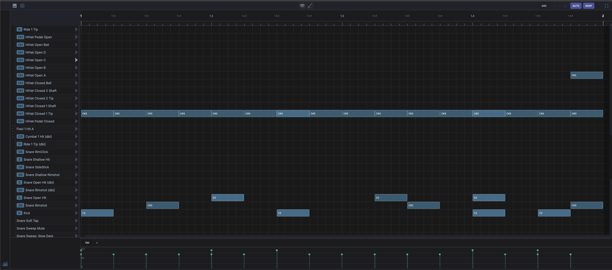

# Drum Grid Editor

Displayed in the bottom panel when you select a MIDI clip on a track whose instrument opens in the Drum Grid — a [Drum Grid](../devices/drum-grid.md) device does by default. Switch between this editor and the Piano Roll with the two tabs at the left of the header. Right-click the **Drum Grid** tab and choose **Use Drum Grid by default for** *instrument* to make another instrument open here too.

Shows a step-sequencer-style grid:

- **Rows** represent drum pads / MIDI notes
- **Columns** represent time steps
- **Click** an empty cell to add a hit; **double-click** a hit to remove it
- ++shift++ **+ drag** along a row to stamp a run of hits, one per grid step
- **Velocity** per hit is adjustable in the velocity lane, or with ++shift++ **+ wheel** (see [Auditioning Hits](#auditioning-hits))
- **Live input highlight** — with the track's input monitoring on, pad rows light up as you play them and the played row scrolls into view

!!! note "Header controls"
    - **Piano Roll** / **Drum Grid** — Switch editors for the clip
    - **Overlay tracks** — Show other tracks' notes as a ghost overlay (*Layer clips from other tracks*), same as in the [Piano Roll](piano-roll.md#overlay-tracks-ghost-notes). Ghost hits land on the row matching their pitch; notes that do not map to a pad row are skipped.
    - **Edit tools** — **Pointer**, **Pencil**, **Slice**, **Glue**, and **Erase** (keys ++1++ to ++5++), shared with the Piano Roll. With **Erase**, click or sweep over hits to remove them.
    - **Time Bend** — Show the clip's time bend (see [Time Bend](../time-bend.md#drum-grid-editor))
    - **Key** — The song key chip, shared with the Piano Roll
    - **Loop** — Toggle the clip's own source loop on or off
    - **Grid division**, **AUTO**, **SNAP** — Pick the grid subdivision, let it follow the zoom level, and toggle snap-to-grid
    - **Clip power** — Enable or disable the clip
    - **Maximise** — Pinned to the far right, this toggle expands the editor to fill the window. Click again to restore. Shared with the Piano Roll.

!!! note "Sidebar controls"
    - **Chord track** — Show the chord track's chords in a lane above the grid
    - **Monitor** — Hear hits as you click them (see [Auditioning Hits](#auditioning-hits))
    - **Fold** — Collapse the grid to only the pads in use, hiding empty lanes (**Fold to used pads**)

Right-click the grid for **Copy**, **Paste**, **Duplicate**, **Delete**, **Slice...** (see [Slicing Notes](piano-roll.md#slicing-notes)), the default length and velocity for new hits, and **Quantize**.

## Velocity and Control Lanes

The drawer at the bottom of the editor holds the velocity lane. Drag the bars to set hit velocities. Click a pad row's name to select the row: the velocity lane then shows only that row's hits (*VEL · selected row*).

The buttons at the left of the drawer switch it to CC and pitchbend lanes, which you add with the **+** button the same way as in the [Piano Roll](piano-roll.md#control-lanes). The menu offers **Pitchbend**, common controllers (**CC 1 (Mod Wheel)**, **CC 7 (Volume)**, **CC 11 (Expression)**, **CC 64 (Sustain)**), and **Custom CC...**

## Auditioning Hits

The **Monitor** toggle in the sidebar previews hits through the track's instrument. With it lit, clicking a cell or pressing a pad sounds that note. It works the same as in the [Piano Roll](piano-roll.md#auditioning-notes), and the setting is shared between the two editors. The play button at the end of each pad row always auditions, whatever the toggle state.

++shift++ **+ wheel** over a hit edits its velocity, exactly as in the [Piano Roll](piano-roll.md#editing-velocity-with-the-wheel).

## Pad Rows

Each pad that holds a sound has a mute button on its row, which mutes the pad's [mixer channel](../mixer-view.md#drum-grid-pad-channels).

When any pad carries a role, the rows group under **KICK**, **SNARE**, **HATS**, and **PERC** headers, in role order; pads without a role join **PERC**. Click a header to fold its group.

## Row Labels and Roles

Each pad row can carry a custom name and an instrument **role**. The role is a semantic label (what the pad *is*: a kick, a snare, a closed hat) and shows as a small coloured pill next to the row, abbreviated to a short tag like `K`, `S`, or `HH`.

Right-click a row to set both:

- **Set instrument** - choose a role from the submenu, or **None** to clear it.
- **Rename label...** - give the row a custom name.
- **Clear label** - remove the custom name.
- **Clear role** - remove the role (leaving the pad unlabelled).

Roles are also what the [Drummer agent](ai-assistant.md#drummer-agent) reads and writes, so labelling your pads lets the AI place hits on the right voices.

The available roles and their short tags:

| Role | Tag | Role | Tag |
|------|-----|------|-----|
| Kick | K | Ride | R |
| Snare | S | Ride Bell | RB |
| Snare Rim | SR | Crash | CR |
| Clap | C | Tom High | TH |
| Closed Hat | HH | Tom Mid | TM |
| Open Hat | OH | Tom Low | TL |
| Pedal Hat | PH | Perc 1-4 | P1-P4 |

## Drumkits

A **drumkit** saves a grid's row layout - each pad's note, custom label, and role - so you can reuse it across projects. Right-click a row to manage kits:

- **Save as drumkit...** - name and save the current grid's row layout.
- **Apply template** - apply a built-in template or one of your saved drumkits to the current grid.

Drumkits store pad metadata (notes, labels, roles), not the samples themselves.

See [Drum Grid](../devices/drum-grid.md) for the DrumGrid device itself, including per-pad sample loading, each pad's chain, and envelopes. Each pad that holds a sound also has its own channel in the [Mixer](../mixer-view.md#drum-grid-pad-channels).
