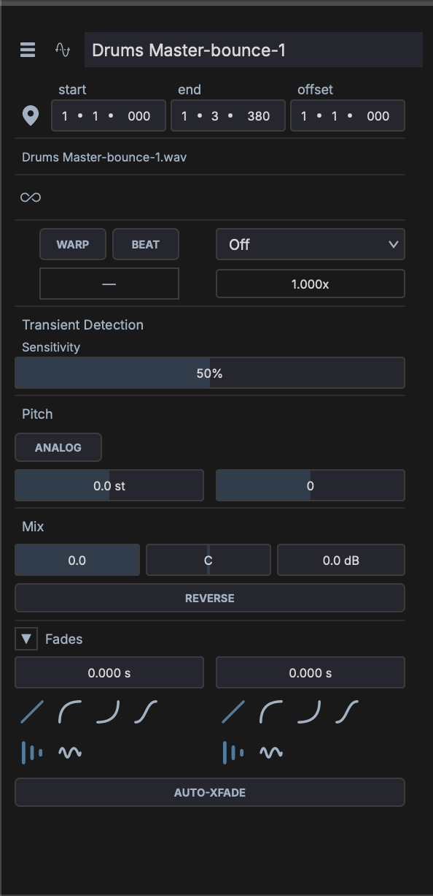

# Inspector

The Inspector panel is on the right side of the window. It displays context-sensitive properties for the currently selected item.

Its sections fold: click a section's title to fold or unfold it. A folded section stays folded as you select other items, until you restart MAGDA. The **FX**, **Latency**, **Mods** and **Macros** sections start folded each time you open MAGDA. When an inspector is taller than the panel, the panel scrolls.

## Track Inspector

Displayed when a track is selected. From the top:

- **Name** — Click to rename. The track colour shows as a spine beside the name, or fills the name field when **Track colour** is set to **Full bar** in **Settings > Appearance**. Click the spine, or right-click the name, to choose a colour. A track with no colour has no spine. The switch at the right enables or disables the track
- **Mix** — Volume and pan, **M** (mute), **S** (solo), **R** (record arm), input monitoring, and the automation button, which lights when the track has automation
- **Automated** — Appears when the track has automation and lists the automated parameters. The automation button folds it away
- **Routing** — Audio and MIDI input and output selectors
- **FX** — The track's FX chain, one row per device (a rack shows as one row). Click a row's dot to bypass the device; click its chevron to unfold up to three of its parameters, chosen in the **Mini FX** column of the [Configure Parameters dialog](../plugin-parameters.md). Third-party plugins have a button that opens their window. The section header shows the track's total latency
- **Sends** — The track's sends with their levels; the **+** in the section header adds a send
- **Mods** and **Macros** — The track's own [modulators](../modulation/modulators.md) and [macros](../modulation/macros.md), see [Mods and Macros](#mods-and-macros)
- **Clips** — How many clips the track holds

Which of these a track shows depends on its type: a group or aux has no record or input routing, for example. With several tracks selected, the inspector names how many, and mute, solo, record arm, enable, and colour apply to all of them.

## Master Inspector

Displayed when the master is selected:

- **Header** — The master's channel layout and how many devices its chain holds, with a mute button
- **Output** — Volume and a live peak meter. Click the peak readout to reset it
- **FX** — The master chain, in the same rows as the track inspector's FX section
- **Latency** — The master chain's total latency in milliseconds and samples, and the devices that add the most (up to five)
- **Mods** and **Macros** — The master's own modulators and macros

## Clip Inspector

Displayed when a clip is selected. The header shows the clip's colour spine and name over a summary line: the clip type, *Session* for a Session View clip, the take, its length in bars, and the sample rate (audio) or note count (MIDI). Double-click the name to rename the clip. Click the spine, or right-click the name, to choose a colour: **None**, **Inherit from Track**, or a palette colour. A clip with no colour has no spine. Beside the name sit **Save to library**, which saves the clip's settings or MIDI file to the media library, and the power button that enables or disables the clip.

Position and loop values are expressed in **beats** (shown as bars and beats). The sections below appear for the kinds of clip they apply to.

### Clip

- **Clip** — **Start**, **End** and **Length** on the timeline
- **Loop** — The loop switch, with the loop's start and end and its **Phase** (or offset)
- **Takes** — For a clip with recorded takes, the take to play

### Mix

For audio clips:

- **Volume**, **Pan** and **Gain**
- **Reverse** — Play the clip backwards
- **Gain envelope** — Show the clip's gain envelope

### Warp & Pitch

For audio clips. The switch in the section header turns warp markers on or off.

- **Beat** / **Free** — Beat follows the project tempo in bars and beats; Free plays the file at its own rate
- **Stretch engine** — **Off**, **Signalsmith**, **SoundTouch**, or **SoundTouch HQ**
- **Transient sensitivity** — How readily transient markers are detected
- **Tempo** and **Length** — The source tempo in BPM, with buttons that halve or double it, and the length in beats
- **Speed** and **Analog** — In Free mode, the playback speed, and analog pitch, which resamples instead of time-stretching
- **Pitch** — Transpose in semitones and cents
- **Key** — The source's key root

### Pitch

For MIDI clips: **Transpose** buttons that move every note down or up an octave or a semitone (−12, −1, +1, +12).

### Fades

For audio clips: fade-in and fade-out lengths, each with its curve shape. **Crossfade in** and **Crossfade out** appear where the clip overlaps a neighbour, and the switch in the section header crossfades automatically where clips overlap. A Session View clip has a **Launch** fade instead, which smooths the start (0 keeps the transient).

### Time Bend

For MIDI clips: the clip's [time bend](../time-bend.md) curve.

### Labels

For audio clips: the clip's labels, placed with the Label tool in the waveform editor.

### Launch

For clips in Session View:

- **Quantize** — Bar / beat snap for launch timing
- **Follow action** — Action when the clip ends: None, Play Next, Play Previous, Play Random, Stop, Play Again
- **Delay (beats)** - Delay between the clip ending and the follow action firing (0 - 64 beats)
- **Loops** - Number of loops the clip plays before the follow action fires

**Delay** and **Loops** appear once a follow action is set.

## Note Inspector

Displayed when one or more MIDI notes are selected in the Piano Roll. The header names the note (or how many are selected) over the clip's name. Shows:

- **Pitch** — MIDI note number and name
- **Velocity** — Note velocity (0–127)
- **Start** — Note start position
- **Length** — Note duration

When multiple notes are selected, the inspector shows ranges (e.g., "C3–G5") and allows batch editing.

## Automation Inspectors

Selecting automation points shows the parameter's name over how many points are selected, with the **Value** and **Position** of the selection. With several points selected, editing the value moves them all by the same amount.

Selecting an automation clip shows its name over a summary line (the automated parameter and the clip's length), with the **Start**, **End** and **Length** of the clip, and the **Loop** switch with the loop's length. Right-click the name to choose the clip's colour.

## Device Inspector

Displayed when a device, rack, or chain is selected in the track chain:

- **Header** — The device type (for example its plugin format, *Instrument* or *Effect*, and the manufacturer) over the device's name
- **Facts** — The device's **Category** (for MAGDA's own devices), its **Latency**, and, for a device with a sidechain input, where its **Sidechain** comes from
- **Mods** and **Macros** — The device's or rack's own modulators and macros
- **About** — A short description, for MAGDA's own devices

The device's parameters live on the device itself, in the [track chain](track-chain.md).

## Mods and Macros

The track, master, and device inspectors each show the selected item's own **Mods** and **Macros**, using the same cards, knobs, and editors as the [track chain](../modulation/overview.md). Edits made in either place show in the other. Click a card to open its editor below the cards.

Clicking a modulator or macro in the chain selects its owner and opens that item here, unfolding its section. Post-FX devices, analysis devices, and the chord track have no mods or macros, so they show none here either.
