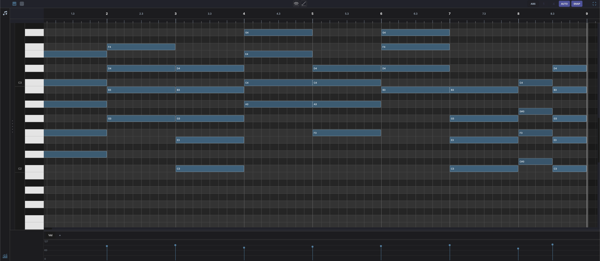

# Piano Roll

Displayed in the bottom panel when a MIDI clip is selected. Provides a grid for editing notes:

- **Horizontal axis** — Time (bars and beats)
- **Vertical axis** — Pitch (MIDI note numbers, with piano keyboard on the left)
- **Vertical zoom** — Drag the zoom strip on the far-left edge (beside the octave labels and keyboard) up or down to change the note row height. The zoom level is remembered per clip.
- **Double-click** an empty cell to add a default-length note at that position and pitch
- ++alt++ **+ drag** on empty grid to draw a note of variable length. The drag distance sets the note length. The **Pencil** tool does the same without the modifier.
- **Drag** a note to move it in time or pitch; ++alt++ **+ drag** a note to copy it
- **Drag edges** to resize note length
- ++shift+ctrl++ **+ click** a note to delete it directly. If the note is part of a multi-selection, the whole group is erased. Acts as a rubber tool.
- **Control lanes** at the bottom for velocity, CC, pitchbend and MPE (see [Control Lanes](#control-lanes))
- **Live input highlight** — with the track's input monitoring on, the keyboard lights up notes as you play them (MIDI or computer keyboard) and scrolls a held note into view

## Toolbar

!!! note "Toolbar controls"
    - **Piano Roll / Drum Grid** — Switch this clip between the Piano Roll and the [Drum Grid Editor](drum-grid-editor.md)
    - **Layer clips** — Show other tracks' notes as a ghost overlay (see [Overlay Tracks](#overlay-tracks-ghost-notes))
    - **Edit tools** — Pointer, Pencil, Slice, Glue and Erase (see [Edit Tools](#edit-tools))
    - **Time Bend** — Show the clip's time bend in a panel beside the grid (see [Time Bend](#time-bend))
    - **Key** — The project's key, with scale highlighting (see [Scale Highlighting](#scale-highlighting))
    - **Maximise** — Expand the editor to fill the window. Click again to restore.
    - **Power** — Enable or disable the clip
    - **ABS / REL** — Toggle between absolute (timeline) and relative (clip) time. Hidden for Session View clips, and locked to relative while an arrangement clip loops.
    - **Grid** — The grid division (click it to pick one), **AUTO** to follow the zoom level, and **SNAP** to snap to the grid
    - **Loop** — Toggle the clip's own loop on or off

!!! note "Rail"
    Stacked on the left edge:

    - **Chord track** — Show the chord lane above the grid (see [Chord Timeline](#chord-timeline))
    - **Monitor** — Hear notes as you click them (see [Auditioning Notes](#auditioning-notes))
    - **Fold** — Collapse the grid to only the pitches in use (see [Fold](#fold))
    - **Show take lanes** — At the bottom, when the clip holds recorded takes (see [Take Lanes](#take-lanes))

## Edit Tools

Pick a tool in the toolbar, or press its number key. Holding the key switches tool only while it is held, and holding ++alt++ switches to the Pencil.

| Tool | Key | What it does |
|------|-----|--------------|
| **Pointer** | ++1++ | Select, move and resize notes |
| **Pencil** | ++2++ | Draw notes on the empty grid |
| **Slice** | ++3++ | Cut a note where you click |
| **Glue** | ++4++ | Join a note to the next note of the same pitch |
| **Erase** | ++5++ | Delete notes by clicking or sweeping over them |

## Auditioning Notes

The **Monitor** button sits at the top of the rail. When it is lit, notes sound through the track's instrument as you work on them:

- **Click** an existing note to play it.
- ++alt++ **+ drag** to draw a note and hear it for as long as you hold.
- **Double-click** to add a note and it sounds once.

The toggle is off by default, so ordinary selection stays silent. Its state persists as you switch clips and move between the Piano Roll and the [Drum Grid Editor](drum-grid-editor.md) within a session.

## Control Lanes

The drawer at the bottom of the editor shows one kind of lane at a time. Pick it with the three buttons at the top of the drawer's header column:

- **Velocity** — One bar per note. Drag the bars to set note velocities; selected notes edit together.
- **CC and pitchbend** — The clip's CC and pitchbend lanes, stacked so they are all visible at once. Add one with the **+** button at the bottom of the header column: the menu offers **Pitchbend**, common controllers (**CC 1 (Mod Wheel)**, **CC 7 (Volume)**, **CC 11 (Expression)**, **CC 64 (Sustain)**) and **Custom CC...** for any controller number. Each lane shows its name with a close button, and the pitchbend lane has a **Range** field for the bend range in semitones.
- **MPE** — Pitch glides on the notes, with **Slide** and **Pressure** lanes below (see [Pitch Glides (MPE)](#pitch-glides-mpe)).

Drag the drawer's top edge to resize it. The drawer grows automatically as CC lanes are added. A pencil or curve stroke in a lane is one undo step.

## Editing Velocity with the Wheel

Hold ++shift++ and scroll the wheel over a note to nudge its velocity, in steps and clamped to 1-127. If the note is part of the current selection the whole selection scales together; otherwise only that note changes. ++shift++ **+ wheel** over the empty grid edits the current selection. A small `v NN` readout appears by the cursor while you drag, and a full wheel spin collapses into a single undo step.

While a note is hovered or a selection exists, this gesture takes over from the usual ++shift++ **+ wheel** horizontal scroll.

## Fold

The **Fold** button collapses the vertical axis to only the pitches that are actually used in the clip, hiding the empty rows in between. Every remaining row is labelled, and the view re-centres on the used notes when you toggle it. Folding is handy on sparse parts — a bassline or a lead — so you can see all the notes without scrolling. With Fold on, dragging a note vertically snaps through the used-pitch rows. While the key is lit, Fold keeps the key's rows as well. The same control exists in the [Drum Grid Editor](drum-grid-editor.md) as **Fold to used pads**.

## Scale Highlighting

The key button in the toolbar shows the project's key. Click it to pick a root note and **Major** or **Minor**, choose **No Key**, or turn on **Highlight scale and fold to key**. While the highlight is lit, rows in the scale stand out, the root's rows are marked, and notes outside the scale are hatched, along with their velocity bars.

## Take Lanes

When a MIDI clip holds more than one recorded take, click **Show take lanes** at the bottom of the rail to reveal the folded take strip below the grid and comp the takes together. See [Recording Takes & Comping](../recording-comping.md#comping-midi).

## Pitch Glides (MPE)

Choose **MPE** in the control-lane drawer to edit per-note expression. In this mode you draw pitch glides directly on a note: the glide curve bends the note's pitch over its length, independently of other notes. Right-click a glide for **Clear Pitch Glide**. Playback uses MPE, so each gliding note gets its own MIDI channel — point the track at an MPE-capable instrument to hear it.

Below the grid, the **Slide** and **Pressure** lanes edit the selected note's slide and pressure curves within the note's length. Select one note to edit them; with no note or several selected, the lanes are read-only. Each edit is one undo step.

## Overlay Tracks (Ghost Notes)

Click the **Layer clips** button in the toolbar (next to the Piano Roll / Drum Grid tabs) to overlay MIDI from other tracks as ghost notes. The menu lists every other track that has MIDI clips; tick as many as you like — the menu stays open while you toggle, and **Clear All** removes them all at once.

Ghost notes render dimmed in the source clip's colour, aligned on the shared timeline, and are never interactive: they are reference material for harmony and counterpoint while you edit the active clip. The overlay selection persists while you switch clips or move between the Piano Roll and Drum Grid Editor.

## Time Bend

The **Time Bend** button opens the clip's time bend in a panel beside the grid. The bend moves when notes play without changing them as written: the grid dims each note where it is written and draws it where it plays, updating as you shape the curve. **GROOVE** and **BAKE** sit above the curve, to load a groove and to write the bend into the notes. See [Groove & Time Bend](../clips.md#groove-time-bend) and [Time Bend](../time-bend.md).

## Slicing Notes

The **Slice** tool cuts a note in two where you click. To cut notes into equal pieces, select one or more notes, right-click and choose **Slice...**. A popup shows how many notes are selected and a **SLICES** control. Set how many equal pieces to divide each selected note into (2 to 32, default 4), then click **Apply** or press ++enter++.

Each selected note is split into that many equal-length pieces end to end, keeping the original pitch and velocity. The slices land on the same track in place of the original notes, and they become the new selection so you can immediately edit or slice them again. The action is undoable (++ctrl+z++ to revert). Click **Cancel** or press ++esc++ to dismiss without changing the clip.

Slicing is available in both the Piano Roll and the [Drum Grid Editor](drum-grid-editor.md).

## Chord Timeline

The **Chord track** button in the rail shows a **chord row** above the note grid with chord annotations. It is on by default when a [Chord Engine](../devices/chord-engine.md) is on the track, and the choice is remembered per clip. Chords can be placed by dragging from the Chord Engine's suggestion grid, or detected from existing notes with the refresh button (**Recalculate chords from notes**). Annotations are linked to their MIDI notes and update automatically when notes are moved, resized, or deleted. On tracks other than the chord track, a second button compares the row against the [chord track](../chord-track.md)'s progression. See [Chord Engine — Chord Timeline](../devices/chord-engine.md#chord-timeline) for details.
