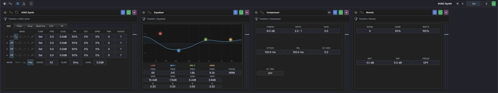

# Track Chain

Displayed in the bottom panel when a track or device is selected. Shows the track's FX chain as a horizontal strip of devices:

- **Drag** devices to reorder them in the chain
- **Click** a device to select it and show it in the [Inspector](inspector.md#device-inspector)
- **Drag** plugins from the Plugin Browser onto the chain to add them, or click the **+** at the end of the chain
- **Right-click** a device for **Add to New Rack** and **Delete**; ++backspace++ deletes the selected devices
- **Racks** are shown as containers with nested parallel chains

See [FX Chain & Racks](../fx-chain.md) for working with devices, presets, and racks.

When you select a Drum Grid pad's channel, the panel shows that pad's chain, and devices you add land in the pad's chain.

## Header Controls

The header runs across the top of the panel. From the left:

- **Track macros** / **Track modulators** — show the track's own [macro](../modulation/macros.md) and [modulator](../modulation/modulators.md) panels at the start of the chain
- { width="16" } **Add rack** / **Add multiband rack** — create a new rack on the track
- **Gain staging** — start a [gain-staging](../fx-chain.md#gain-staging) pass
- **Presets** — the [track preset](../fx-chain.md#track-chain-presets) box and the floppy disk that saves one
- **Track name**
- **Post-FX panel**, **Oscilloscope**, **Spectrum Analyzer**, **Levels** — show the [post-FX panel](../fx-chain.md#post-fx-section), and add or remove each analyzer there
- **MIDI light**, **M** (mute), **S** (solo)
- **Volume** and **pan**
- { width="16" } **Power** — switch the whole track chain on or off
- **Fold** — the chevron at the far right

The master shows no MIDI light, solo, pan, or power. On a pad channel the presets, gain staging, multiband rack, and power buttons are hidden. The chord track shows only its name, volume, and its audition control.

## Folding the Header

Click the chevron at the right end of the header to fold it to a thin, darker strip; the controls fade out as it folds. The MIDI light stays visible on the strip. Click anywhere on the strip to bring the header back.

Right-click the strip (or the chevron) for a menu that shows or hides the **Post-FX Panel** and adds or removes the **Oscilloscope**, **Spectrum Analyzer**, and **Levels** analyzers.

MAGDA remembers whether the header is folded between sessions. Folding applies to the track chain only; the other bottom-panel editors keep their toolbars.
