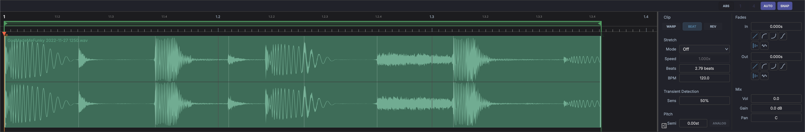

# Waveform Editor

The Waveform Editor is the audio clip editor in the bottom panel. It opens when you select an audio clip and shows the clip's source file, where you trim and loop the clip, place warp markers and labels, and draw its gain envelope.

## Layout

- **Toolbar** across the top (see [Toolbar](#toolbar)).
- **Rail** down the left edge. Its buttons switch the [spectrogram](#spectrogram) and the [transient markers](#transients) on and off; the button at the bottom opens and closes the properties panel.
- **Ruler and waveform** in the middle. The waveform draws in the clip's colour, one lane per channel.
- **Properties panel** on the right (see [Properties Panel](#properties-panel)). Drag its left edge to resize it.
- **Scroll bar** along the bottom. Drag its thumb to scroll and its ends to zoom.

## Toolbar

- **Clip name** on the left.
- **Tools** in the centre. While the waveform is showing, they are **Pointer**, **Label** and **Marker** (see [Warp Markers](#warp-markers) and [Labels](#labels)). While the gain envelope is showing, they are **Line**, **Pen** and **Flat** (see [Gain Envelope](#gain-envelope)).
- **Maximise** expands the editor to fill the window; click again to restore.
- **Power** enables or disables the clip.
- **Grid** - the grid division (click it to pick one), **AUTO** to follow the zoom level, and **SNAP** to snap to the grid.
- **Loop** turns the clip's loop on or off. On a free clip it puts the clip into beat mode first (see [Looping](../clips.md#looping)).
- **Gain envelope** shows or hides the clip's gain envelope.

## Editing the Clip

With the **Pointer**:

- Drag the left edge of the audio to trim the clip's start, and the right edge to trim its end (when the clip doesn't loop).
- Hold ++shift++ while dragging an edge to stretch the clip instead of trimming it.
- When the clip loops, drag the phase marker to change where playback starts in the loop, and drag the ends of the loop in the ruler to change the loop region.
- Drag in the body of the waveform to zoom around the pointer.

Double-click the ruler above the ticks to fit the view to the loop, or to the whole clip when it doesn't loop. A double-click on the ticks themselves places the edit cursor.

Right-click the waveform for **Show Pre-Marker Audio** and **Show Post-Marker Audio**, the slice commands (see [Slicing](../clips.md#slicing)), and **Reset Beat Grid Origin** once the grid origin has been moved. When the clip holds recorded takes, the menu also offers **Expand Takes** / **Collapse Takes** and the comp commands; see [Recording Takes & Comping](../recording-comping.md#comping-audio).

## Warp Markers

With **Warp** on (in the properties panel or the Inspector), warp markers pin points in the audio to positions on the timeline. They draw as hairlines with a flag at the top. See [Warp Markers](../clips.md#warp-markers) for what they do.

- **Add** - choose the **Marker** tool and click the waveform. A dotted guide follows the pointer to show where the marker will land. The tool is greyed out while Warp is off.
- **Move** - drag a marker to stretch the audio on either side of it. ++alt++ + drag moves it without stretching.
- **Delete** - double-click a marker, or right-click it and choose **Remove Warp Marker**.

## Gain Envelope

Click the gain envelope button in the toolbar to show the clip's [gain envelope](../clips.md#gain-envelope). The waveform dims, the sample markers hide, and the curve draws in the clip's colour over dB guides. An empty envelope is a flat 0 dB line. The envelope ranges from silence up to +6 dB.

Draw it with the envelope tools:

| Tool | What it does |
|------|--------------|
| **Line** | Drag a straight ramp. The default tool |
| **Pen** | Draw the envelope freehand |
| **Flat** | Click a grid cell to hold it at one level |

Each stroke is one undo step. The same tool edits the envelope on the clip in the arrangement while it is shown there. Whether the envelope is shown is saved with each clip.

## Labels

Labels name a part of the source file - a verse, a breath, a hit - without changing how the clip plays. A label is a named, coloured region, or a single point.

- **Add** - choose the **Label** tool, then click to place a point label or drag to label a region.
- **Move or resize** - drag a label's flag on the top edge of the waveform to move it, or drag its ends to resize a region. Moving a label never stretches the audio.
- **Edit** - right-click a label for **Rename Label...**, **Colour** and **Delete Label**. Double-clicking a label also deletes it.

Labels are saved with the project, follow linked ghost clips and pasted copies, and travel with the file into the [Media Library](media-library.md). The Inspector lists a clip's labels in its **Labels** section.

## Spectrogram

The spectrogram button in the rail swaps the waveform for a spectrogram, which shows the frequencies in the audio over time, from 30 Hz to 20 kHz on a logarithmic scale. Stereo files show the sum of both channels. The choice applies to every clip and is remembered between sessions.

The waveform stays on screen until the spectrogram is ready, which on a long file can take a moment. Markers, labels and the envelope draw on top as usual.

## Transients

The transient button in the rail shows or hides the transient markers MAGDA detects in the audio. How many it finds is set by **Sens** in the properties panel, or **Transient sensitivity** in the Inspector; even at the lowest setting the strongest onsets still show, so hide them with the button when you don't need them.

## Properties Panel

The panel on the right gives quick access to the clip's settings without switching to the [Inspector](inspector.md):

| Section | Controls |
|---------|----------|
| **Clip** | **WARP**, **BEAT** and **REV** (reverse) |
| **Stretch** | **Speed**, the stretch **Mode**, the source **BPM** and length in **Beats**, and its **Key** |
| **Pitch** | **Semi** (semitones) and **Analog** |
| **Transients** | **Sens** (detection sensitivity) |
| **Fades** | Fade in and out, with curves and behaviours, and the crossfade lengths |
| **Mix** | **Vol**, **Gain** and **Pan** |

A bookmark button saves the clip's current settings to the [Media Library](media-library.md). See [Audio Clip Properties](../clips.md#audio-clip-properties) for what each setting does.

Selecting several audio clips at once keeps the editor open in a multi-clip mode, where the Fades section edits all of them together.

## Clips on ARA Tracks

On a track with an [ARA plugin](../ara.md), the plugin plays the raw file, so the editor stands down MAGDA's own processing: **Loop** and the gain envelope button are greyed out, warp markers and the loop phase marker can't be edited, and ++shift++ + dragging an edge trims instead of stretching.

## Edit in an External Editor

To do destructive editing in another application (Audacity, iZotope RX, and so on), right-click an audio clip and choose **Edit in External Editor**. MAGDA hands the clip's source file to the application you have configured, so changes you save there are reflected back in MAGDA.

Set which application to use under **External audio editor** in **Settings > Paths** (see [Settings](../interface/preferences.md#external-audio-editor)). If none is set, MAGDA asks you to choose one first.
