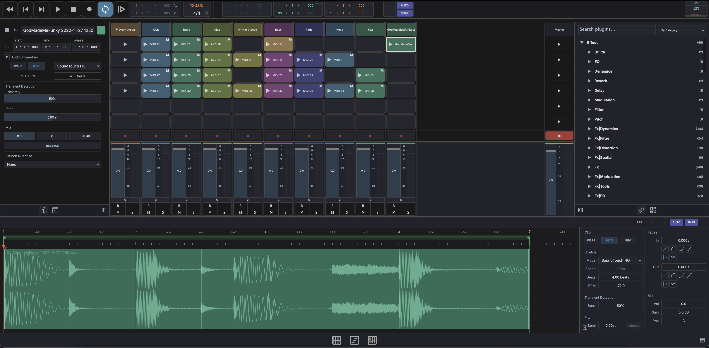

# Session View

The Session View is a grid-based clip launcher for real-time performance and idea sketching. Switch to it by clicking the **Session** button in the footer bar.



## Layout

The Session View is organized as a grid:

- **Columns** represent tracks
- **Rows** represent scenes
- Each cell is a **clip slot** that can hold an audio or MIDI clip

The [chord track](chord-track.md) is always the first column on the left. Aux tracks sit in their own section on the right, next to the scenes column, with a small gap between them and your other tracks. They stay put while the other columns scroll.

```
     Track 1    Track 2    Track 3   │ SCENES
    ┌──────────┬──────────┬──────────┼──────────┐
    │ ▶ Clip A │ ▶        │ ▶ Clip D │ 1 ▶ Scene│
    ├──────────┼──────────┼──────────┼──────────┤
    │ ▶        │ ▶ Clip B │ ▶ Clip E │ 2 ▶ Scene│
    ├──────────┼──────────┼──────────┼──────────┤
    │    +     │    +     │    +     │    +     │
    ├──────────┼──────────┼──────────┼──────────┤
    │    ■     │    ■     │    ■     │ STOP ALL │
    ├──────────┼──────────┼──────────┼──────────┤
    │ meter    │ meter    │ meter    │ MASTER   │
    │ vol  pan │ vol  pan │ vol  pan │ meter    │
    │  M    S  │  M    S  │  M    S  │ vol      │
    └──────────┴──────────┴──────────┴──────────┘
```

- **Track headers** run across the top — click to select a track
- **Scene buttons** in the **SCENES** column on the right launch every clip in their row
- The **+** row below the last scene adds a scene
- The **stop row** has a stop button (■) for each track, and **STOP ALL** stops every playing clip
- **Mini mixer** strips at the bottom provide quick mixing controls, with the master's in the scenes column
- The **toggle rail** runs down the left edge (see [Toggle Rail](#toggle-rail))

## Clip Slots

Each cell in the grid is a clip slot. A slot can be empty or contain a clip.

- **Click** the launch triangle (▶) at the left of a slot to trigger its clip. Clicking it again while the clip plays triggers it again.
- **Click** the left edge of an empty slot to stop the clip playing on that track, or to start recording into the slot when the track is armed.
- **Click** the track's stop button (■) in the stop row to stop its clip.
- Only one clip per track plays at a time — triggering a new clip in the same column stops the previous one.
- **Double-click** a clip to open it in the editor at the bottom of the window. Double-clicking an empty slot creates a MIDI clip there.
- **Right-click** a slot for **Create MIDI Clip**, **Copy**, **Cut**, **Duplicate**, **Paste**, **Delete Clip**, **Add Scene** and **Remove Scene**.

A queued clip's border blinks until it starts, and a playing clip shows its progress across the slot.

Not every track takes clips. An aux track's slots stay empty, and a group track's slots launch the clips of the tracks inside it rather than holding any of their own.

While recording into a slot, the clip previews in real time — incoming MIDI notes and captured audio peaks draw in the slot as the take happens.

### Selecting Clips

- **Click** a clip's name to select it
- **++shift++-click** another slot to extend the selection to a rectangular range
- **++cmd++-click** (++ctrl++-click on Windows/Linux) to toggle individual slots in or out of the selection
- With several clips selected, **Duplicate** and **Delete Clip** in the right-click menu act on all of them

### Launch Fade

Each session clip has an optional **launch fade** — a per-clip crossfade applied when the clip launches over the clip it replaces on the same track. Set its length with **Launch** in the **Fades** section of the clip's [Inspector](panels/inspector.md). Useful for pad and atmosphere clips where the hard cut between launches is jarring.

## Scenes

A scene is a horizontal row across all tracks. Launching a scene triggers all clips in that row simultaneously, which is useful for transitioning between song sections during a live performance.

- Click the number or triangle (▶) on a **scene button** to launch the scene; click its name to select it
- Click **+** below the last scene to add one, or right-click a slot for **Add Scene** and **Remove Scene**
- Use **STOP ALL** to stop all playing clips at once

## Mini Mixer

At the bottom of the Session View, each track has a mini channel strip for quick mixing without leaving the clip launcher. From top to bottom:

- **Peak meter** — a horizontal meter across the top of the strip
- **Volume** and **Pan** — side by side; drag a value to change it
- **Mute** and **Solo**
- **Record arm** and **Monitor** — in their own row, shown with the rail's record/monitor toggle

With several tracks selected, dragging one strip's volume or pan moves every selected track by the same amount.

The master's strip sits in the scenes column, level with the track strips: the **MASTER** label, its peak meter and its volume.

### Toggle Rail

The rail along the left edge of the Session View shows or hides parts of the view, the same way the [Mixer View](mixer-view.md#toggle-rail) does:

- **Show sends** — the sends section above the mixer strips. Drag the handle above it to make it taller or shorter.
- **Narrow / Medium / Wide track width** — set every channel to that width. Right-click any of the three to edit the widths.
- **Show I/O routing** — the input and output selectors
- **Show record/monitor row** — the record arm and monitor row in each strip

Right-click the sends or I/O area for the same choices in a menu: **Show I/O**, **Show Sends** and **Show Record/Monitor**.

## Drag and Drop

- Drag audio files from the Media Explorer onto a clip slot to import them
- Drag plugins onto a track to add effects

### Multi-Sample Drag and Drop

Select multiple samples in the [Media Explorer](panels/browsers.md) (++shift++-click to extend, ++cmd++-click / ++ctrl++-click to toggle) and drag them into the grid:

- **Drop on empty area** — one new track is created per sample, with each clip placed in a separate scene row so the samples stack vertically down the grid.
- **Drop on an existing track** — clips stack down consecutive scene slots on that track, starting from the drop target.

## Adding Clips

- Drag and drop audio or MIDI files from the [Media Explorer](panels/browsers.md) onto an empty clip slot
- Double-click an empty slot, or right-click it and choose **Create MIDI Clip**, to make a new MIDI clip
- Record into an empty slot on an armed track

!!! note
    Clip launching quantize and follow-action settings are configured in the [Clip Inspector](panels/inspector.md).
