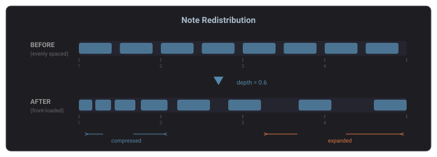
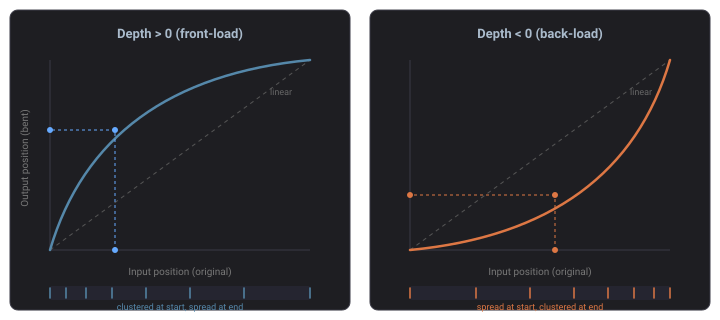
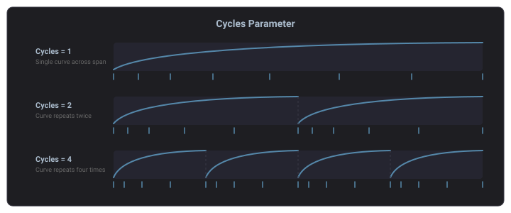
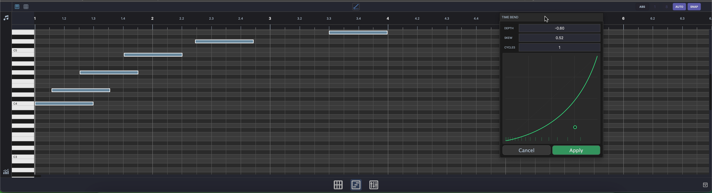

# Time Bend

Time Bend changes when notes play by drawing a curve. The notes stay where they are written; the curve decides when each one is heard, so a part can rush ahead, drag behind, hold still or even run backwards. Grooves are time bends too, and a bend can also carry [dynamics](#dynamics): a level per step that scales how hard each note lands.

Time Bend works on MIDI clips (in the [Piano Roll](#piano-roll), the [Drum Grid Editor](#drum-grid-editor) and the clip Inspector) and in the [Arpeggiator](#arpeggiator), the [Step Sequencer and the Poly Sequencer](#step-sequencer).

## How It Works

Picture a read head moving through the part. Without a bend it moves at a steady pace and every note plays where it is written. The curve tells the head where to be at each moment: time runs from left to right, and the position in the part runs from bottom to top.

- **Rising** — the head moves forward and notes play as written.
- **Steeper** — the head moves faster, so the notes it passes bunch together.
- **Flat** — the head holds still and nothing plays until it moves on.
- **Falling** — the head reads backwards and plays the notes it passes again.

A note plays wherever the head crosses it and keeps its written length. The straight diagonal is the part as written.

## The Editor

The same editor appears everywhere Time Bend does: a header row of controls over the curve.

| Control | What it does |
|---|---|
| Power button | Turns the bend on or off (tooltip *Play through the bend*). Drawing on the curve, picking a shape or loading a groove turns it on. While it is off the curve is dimmed and the part plays as written. |
| **TIME** / **DYNAMICS** | Switches between the curve and the [dynamics](#dynamics). |
| **SHAPE** | Replaces the curve with a starting shape (see [Shapes](#shapes)). |
| **SPAN** 1 / 2 / 4 | How long one pass of the curve lasts, in bars. |
| Grid division | The grid's division: 1/4, 1/8, 1/8T, 1/16, 1/16T, 1/32 or 1/64. It sets the grid lines and what points snap to. A clip starts on 1/16; a device starts on its own step length. |
| **SNAP** | Snaps points to the grid. On by default. |
| **GROOVE** | Loads a groove (see [Grooves](#grooves)). In the header on the Step and Poly Sequencers; above the editor on a clip. |
| **AMOUNT** | How much of the curve you hear: 0% plays the part as written, 100% plays the full curve. Below 100% a fainter line shows the curve you actually hear. |
| **CYCLES** | Repeats the curve 1 to 8 times across the span. |

On a narrow editor, such as a sequencer's faceplate, the header takes two rows and AMOUNT, CYCLES and DYNAMICS shorten to **AMT**, **CYC** and **DYN**.

Behind the curve, the dashed diagonal shows the part as written, with beat and bar lines across it and a faint row for each grid step. On a device, a playhead line moves across the curve during playback.

### Drawing the Curve

| Gesture | Effect |
|---|---|
| Double-click empty space | Add a point |
| Double-click a point | Delete it |
| Drag a point | Move it, together with any other selected points. The first and last points stay at the start and end of the pass. |
| Drag the handle in the middle of a segment | Bow the segment |
| Double-click a segment's handle | Straighten the segment |
| Right-click a segment or its handle | Toggle a **hard corner**: two straight lines meeting at a sharp apex. Drag the handle to move the apex. |
| Drag across empty space | Select the points inside the lasso |
| ++shift++-click a point | Add it to, or remove it from, the selection |
| ++cmd++-drag (++ctrl++-drag on Windows/Linux) | Draw freehand |
| ++delete++ / ++backspace++ | Delete the selected points |
| ++cmd+a++ (++ctrl+a++) | Select every point |

A curve holds up to 32 points.

### Shapes

**SHAPE** replaces the curve with one of these, keeping the span, cycles and amount:

| Shape | What you hear |
|---|---|
| **Straight** | The part as written |
| **Rush** | Notes bunch toward the start of each pass |
| **Drag** | Notes bunch toward the end of each pass |
| **Rush, then drag** | Rush over the first half, drag over the second: notes bunch at both ends of the pass |
| **Hold, then catch up** | Silence for half the pass, then the whole part at double speed |
| **Backwards** | The pass plays in reverse |
| **There and back** | Forward at double speed, then back over the same notes |

### Span and Cycles

**SPAN** sets how long one pass lasts: 1, 2 or 4 bars. **CYCLES** divides the span into equal parts and repeats the curve in each, so in 4/4 a 1-bar span at 4 cycles bends every beat the same way.

## Dynamics

Click **DYNAMICS** (**DYN** on a narrow editor) to draw how hard each step lands. The view shows a bar per step of one pass: sixteenths on a clip, the device's own step on a device, up to 64 bars. *Draw to add dynamics* shows until you draw.

- **Drag** across the bars to draw their levels. Hold ++alt++ to set a bar to full.
- A full bar plays notes at the velocity they were written with; a lower bar plays them softer.
- Drawing turns the dynamics on. In this view the power button turns the dynamics on or off (tooltip *Apply the dynamics*), separately from the curve.
- **AMOUNT** sets how much of the drawn levels you hear: at 0% every note plays as written.
- **Right-click** the bars and choose **Remove dynamics** to delete them.

Dynamics scale each note's velocity as it plays, in MIDI clips, the Step and Poly Sequencers and the Arpeggiator. The velocities written in the clip or the steps don't change. They also work on a straight curve, so you can use dynamics without bending time at all. Because the bars cover one pass of the bend, timing and dynamics repeat together.

## Grooves

Grooves are time bends. Click **GROOVE** to open the groove library: **None** first, then the grooves grouped into Swing, Push Swing, Pull Swing, Push Snare, Pull Snare, Timing and Random, with any others under Custom.

Picking a groove loads its curve at full strength, replacing the bend you had (dynamics included), and **AMOUNT** sets how much of it you hear. **None** turns the bend off. Once loaded, a groove is an ordinary curve: edit it like any other. A project saved with a groove opens with that groove's curve.

## MIDI Clips

A MIDI clip carries its own time bend, and it is live: the notes stay where you wrote them and play where the bend puts them. You can edit it in two places:

- **Inspector** — select one or more MIDI clips and open the **Time Bend** section. The editor grows with the Inspector's width. Edits apply to every selected MIDI clip.
- **MIDI editors** — the **Time Bend** button in the Piano Roll or Drum Grid Editor header (tooltip *Show the clip's time bend*) opens the editor in a panel on the right of the editor. Drag the panel's edge to resize it. The button lights while the clip has a bend in force.

Each gesture on the curve is one undo step.

Above the editor sit **GROOVE** (see [Grooves](#grooves)) and **BAKE**. **BAKE** writes what the bend plays into the notes and turns the bend off: each note moves to where it plays, a note the head crosses twice is written twice, and a note it never reaches is removed. It is available while a timing bend is in force and writes the timing only; dynamics stay as they are. ++ctrl+z++ undoes it.

### Piano Roll

In the [Piano Roll](panels/piano-roll.md), the written notes are dimmed while a bend is in force, and each note is also drawn where it plays. The drawing follows the curve as you drag it.

### Drum Grid Editor

The [Drum Grid Editor](panels/drum-grid-editor.md) works the same way: open the panel with its **Time Bend** button, and the hits show where they play.

## Arpeggiator

The [Arpeggiator](devices/arpeggiator.md)'s faceplate is its time bend, under **TIME BEND**. The bend reshapes when each note of the arpeggio plays: the notes keep their order, but the rhythm changes.

Its amount and cycles are the **Bend** and **Cycles** parameters among the device's controls rather than in the editor's header, so they can be automated and linked to [Macros](modulation/macros.md) and modulators like any other parameter. Beside the curve, **Quantize** pulls bent notes back toward a grid, and **Subdivision** sets how many divisions of the bend's cycle that grid has.

The Arpeggiator has no **GROOVE** button.

## Step Sequencer

The [Step Sequencer](devices/step-sequencer.md) and the [Poly Sequencer](devices/poly-sequencer.md) show their time bend in a column beside the steps. The time bend toggle on the device slot (tooltip *Show the time bend*) shows or hides it, and the choice is saved with the device.

The bend redistributes when the steps fire within each pass. **AMOUNT** and **CYCLES** in its header are the device's bend parameters, so they can be automated and linked to [Macros](modulation/macros.md) and modulators. The grid starts on the sequencer's step length.

On the Arpeggiator and both sequencers, the expand button in the editor's header (tooltip *Expand into the arrangement*) lends the editor to the [Arrangement View](arrangement-view.md#expanded-faceplates) for more room. Click the collapse button or press ++escape++ to put it back.

## Tips

- **Swing** — load a groove from the Swing family, then lower **AMOUNT** for a lighter swing.
- **Rushing or laying back** — pick **Rush** or **Drag**, then bring **AMOUNT** down until it feels right.
- **Stutters and repeats** — a falling segment plays notes again. Start from **There and back** and shorten the falling part.
- **Cross-rhythms** — set **CYCLES** to 3 over a 1-bar span in 4/4 to repeat the shape three times a bar.
- **Accents without moving anything** — leave the curve straight and draw dynamics: higher bars on the beats, lower ones between.
