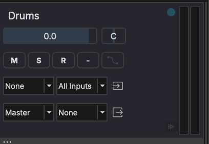
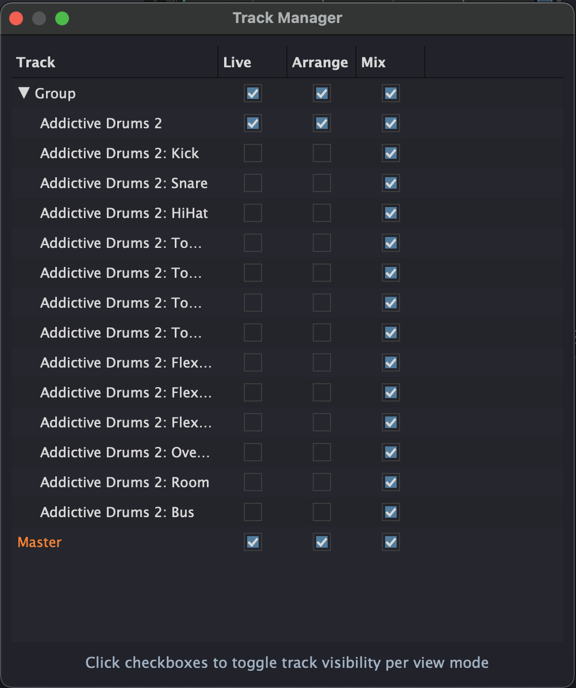
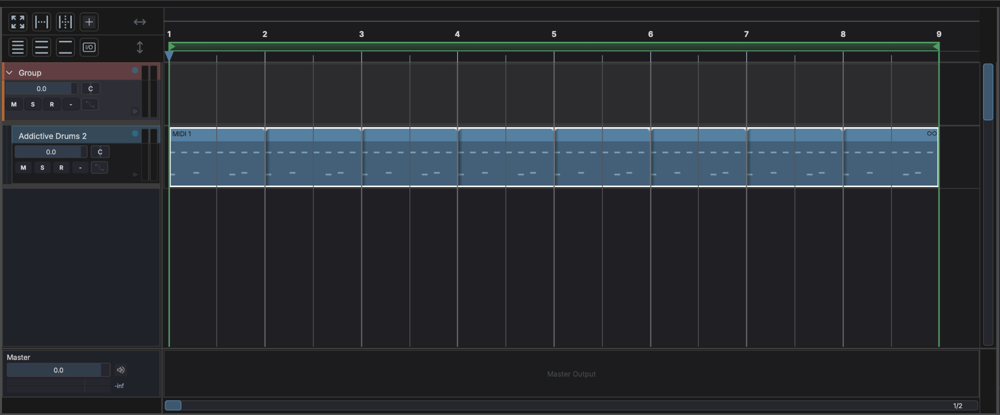
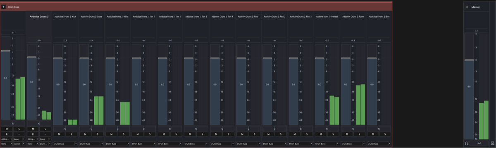

# Tracks

Tracks are the fundamental building blocks in MAGDA. They appear in all three views — as columns in Session View, rows in Arrangement View, and channel strips in Mixer View.

## Hybrid Track System

MAGDA uses a **hybrid track system**: there is no strict distinction between audio and MIDI tracks. Any track can contain any combination of audio clips, MIDI clips, and other clip types. The track's behavior adapts based on the clips and devices it contains.

## Track Types

| Type | Description |
|------|-------------|
| **Audio** | The regular track. It holds audio and MIDI clips, instruments, effects and live input, and can send MIDI out to hardware or to another track |
| **Group** | Bus that sums the child tracks inside it (see [Grouping Tracks](#grouping-tracks)). It holds no clips |
| **Aux** | Send-return track for shared effects, fed by other tracks' sends. It holds no clips |
| **Chord** | Guide track holding a chord progression — one per project (see [Chord Track](chord-track.md)) |
| **Separator** | A divider in the track list, with an optional name (see [Separators](#separators)) |
| **Output** | One stereo output of a multi-output instrument, created from the device (see [Multi-Output Plugins](#multi-output-plugins)) |
| **Master** | Final stereo output — one per project |

The chord track sits at the top of the Arrangement View and at the far left of Session View and the Mixer. Aux tracks sit in their own section above the master in the Arrangement View, and on the right beside the master in Session View and the Mixer.

## Track Controls

Every track provides the following controls. They render identically in the track header and the track [Inspector](panels/inspector.md), and reflow responsively to the width available rather than to fixed height presets, so no control is ever hidden.

- **Volume fader** — Adjust the track's output level
- **Pan knob** — Position in the stereo field
- **Mute** (M) — Silence the track. Shortcut: select the track and press ++m++
- **Solo** (S) — Solo the track. Shortcut: select the track and press ++shift+s++
- **Record arm** (R) — Arm the track for recording
- **Input monitor** — Monitor the live input signal through the track (see [Input Monitoring](#input-monitoring))
- **Automation** — Toggle automation read/write for the track
- **Sends** - Level to each aux / return the track feeds
- **Routing** - Input and output routing for the track (see [Track-to-Track Routing](#track-to-track-routing))
- **Meter** - Peak level meter for the track

The **Automation** button lights purple when the track holds automation.

Tracks that don't take input show fewer controls. An aux track has no record arm, input monitor, routing or sends; the chord track has only its volume and its chord preview; a separator has none.

### Input Monitoring

The input monitor button has three modes:

| Mode | Colour | Behavior |
|------|--------|----------|
| **Off** | Grey | The live input is not monitored |
| **In** | Green | The live input is always monitored, whether or not the track is record armed |
| **Auto** | Blue | The live input is monitored only while the track is record armed |

Click the button to cycle Off → In → Auto, or right-click it to pick a mode from a menu.

To play an instrument without arming its track, for example to practise before recording, set its monitor to **In**.

With **Auto-monitor selected track** enabled (**Settings > General**, under Behavior), selecting a track sets its monitor to Auto and turns the previously selected track's monitor Off. This overrides a mode you set by hand. The option is off by default.

## Multi-Output Plugins

When an instrument plugin has more than two output channels (e.g. Kontakt, Battery, Drum Machine Designer), MAGDA can create separate output tracks for each stereo pair.

- Open the multi-out menu on the device (the { width="16" } button) and activate the output pairs you need
- Each activated pair creates an **independent track** placed directly after the instrument track
- Output tracks behave like any other track — you can rename, reorder, route to groups, and apply FX
- An output track's lane takes MIDI clips only, and they play the parent instrument
- To organize them, select the output tracks and move them into a [Group](#track-types) using the right-click menu

!!! note
    Multi-out tracks receive audio from the parent instrument's rack — their input routing is fixed. Output routing (to master, groups, or aux sends) works normally.

## Track-to-Track Routing

A track can take another track's output as its own input. Every other track appears in the audio-input and MIDI-input selectors, listed after a separator alongside the hardware inputs, in the [Inspector](panels/inspector.md), the track headers, the [Mixer](mixer-view.md), and [Session View](session-view.md).

From the source side, **MIDI Out** can name another track instead of a hardware port. Each track has one MIDI Out, but any number of tracks can send to the same track, which still takes its own MIDI input as well.

### MIDI channels

In the Inspector's routing section, the input and output icons beside the selectors open each track's MIDI channel menu. Once a channel is set, the icon lights up and shows its number.

- **Input** passes only one channel (1–16) of what the track hears from its MIDI devices, for both monitoring and recording. *Any* passes them all.
- **Output** moves everything the track's MIDI Out sends, to a port or to another track, onto one channel. *As is* leaves channels alone. A chosen channel puts all of an MPE clip's notes on that one channel.

Together these drive a multitimbral instrument: give each part its own track, set each track's MIDI Out to the instrument's track and its output channel to the part's channel. A hardware synth works the same way, with each track's MIDI Out on the synth's port.

Self-routing and feedback loops are detected and blocked. Routings are saved with the project, and input monitoring works normally for an internally-routed track.

## Track View Manager

Each of the three views — Session, Arrangement, and Mixer — maintains its own independent track visibility and layout. This means you can show a different set of tracks in each view.

{ width="300" }

Open the Track Manager from the **View** menu to configure track visibility per view. Each column (Live, Arrange, Mix) has independent checkboxes — toggle them to control which tracks appear in each view.

Per-view track settings include:

- **Visible** — Whether the track appears in this view
- **Locked** — Prevent editing the track in this view
- **Collapsed** — For group tracks: collapse or expand children
- **Height** — Track row height (Arrangement View)

### Example: Multi-Output Workflow

A common use case is keeping the Arrangement View clean while having full control in the Mixer. With a multi-output instrument like Addictive Drums, you can hide the individual output tracks from the Arrangement and show only the MIDI track you compose on:

**Arrangement View** — Only the group and the instrument's MIDI track are visible, keeping the timeline uncluttered:

**Mixer View** — All output tracks are visible for independent level, pan, and effects control per drum voice:

## Adding and Managing Tracks

- Press ++ctrl+t++ (++cmd+t++ on macOS) to add an audio track after the selected one, or ++ctrl+shift+t++ (++cmd+shift+t++) to add a group track
- Click the **+** button in the Arrangement View's corner, or right-click the empty area below the tracks, for the add-track menu: **Add Audio Track**, **Add Group Track**, **Add Aux Track**, **Add Chord Track** and **Add Separator**. **Add Chord Track** is greyed out once the project has one. The **Track** menu offers the same items
- Right-click a track header for options: add a track, grouping, sends, freeze, enable or disable, duplicate, delete
- Double-click the track name to rename it

### Multi-Track Selection

Click a track header to select it. Hold ++shift++ and click another header to extend the selection to a contiguous range; ++cmd++-click (++ctrl++-click on Windows/Linux) to toggle individual tracks in or out of the selection. Most track-level actions — mute, solo, delete, group — apply to every selected track in one operation. Freeze applies to the track you right-clicked.

### Disabling a Track

Right-click a track header and choose **Disable Track**, or use the power switch in the track inspector. A disabled track renders nothing. Its clips, devices, sends and output all fall silent, and anything routed into it stops there. This applies to exports and bounces too. Its header dims and reads *Disabled*. Choose **Enable Track** to bring it back.

A track is also disabled when its chain holds a MAGDA device this copy of MAGDA does not have, for example one from an extension that is not installed, or one from a newer version. Rather than play the chain without it, the track stays silent. Its header names the missing device, and the device's slot reads *Not in this build*. The track can't be enabled until the device is removed or replaced. Until then the device keeps its settings and saves them unchanged, so the project opens as it was in a copy of MAGDA that has it.

## Separators

A separator divides up the track list. It has no header, controls, signal or clips: it is a thin row across the arrangement and a vertical line in the Session View and the Mixer.

Choose **Track → Add Separator** to add one after the selected track, or choose **Add Separator** from the add-track menu, then drag it where you want it in the arrangement or the Session View. A separator starts without a name. Double-click it, or right-click it and choose **Rename Separator...**, to give it one.

With **Add a separator after a new chord track** on (**Settings > General**, under Behavior; on by default), adding a chord track also adds a separator after it. Drag its edge to make it a little taller or wider. Separators don't take a position on [control surfaces](reference/osc-addresses.md), and they aren't exported to DAWproject files.

## Grouping Tracks

Group tracks collect several tracks under a single bus so you can fold them away and control them together. Right-click a track header for the grouping actions:

- **Group tracks** — with two or more tracks selected, collects them into a new group track.
- **Ungroup tracks** — on a group track, dissolves it and promotes its children back to the top level.
- **Remove from Group** — moves a track out of its group, back to the top level.
- **Move to Group** — a submenu listing the existing group tracks; pick one to move the track into it.

Collapse or expand a group's children from the [Track Manager](#track-view-manager) or the group header. The chord track and separators can't join a group.

## Duplicating Tracks

MAGDA offers three duplication modes, available from the **Track** menu, the track header right-click menu, and via keyboard:

| Mode | Shortcut | Copies clips | Copies FX chain |
|------|----------|:---:|:---:|
| Duplicate Track | ++ctrl+d++ / ++cmd+d++ | yes | yes |
| Duplicate Track Without Content | ++ctrl+shift+d++ / ++cmd+shift+d++ | no | yes |
| Duplicate Track Content Only | ++ctrl+alt+d++ / ++cmd+alt+d++ | yes | no |

**Duplicate Track Content Only** is useful when you want the clips on a clean signal path — the new track has the same structure and name, but its FX chain is empty.

## Freezing Tracks

Freezing renders a track to an audio file and plays the file in its place, so the track's instruments and effects stop costing CPU. Right-click the track header and choose **Freeze Track**; a progress window shows while it renders. Choose **Unfreeze Track** to go back to the live chain.

- The file holds the track's signal up to its fader, together with every track routed into it, from the start of the project to the last clip plus the tail its devices declare.
- Devices after the fader keep running live.
- Tracks routed into the frozen track stop playing on their own, since the file already holds them, and their devices show greyed out.
- A frozen track's header dims, with a cyan strip on its outer edge, and its clips can't be edited until you unfreeze it.
- Only audio tracks can be frozen. A disabled track can't be, and neither can a track that outputs into another track: freeze the track it feeds instead.
- The file is kept in the project's renders folder, under `freeze`.

### Unloading plugins on freeze

With **Unload plugins when freezing, to free their memory** on (**Settings > General**, under Engine; on by default), freezing also closes the plugins whose sound the file now holds: those before the fader and those on tracks routed into the frozen track. **Unfreeze Track** loads them again with their settings. A large sampler takes as long to come back as it takes to open, and an instrument stays silent until it has loaded. Devices after the fader stay loaded.

With the option off, the plugins stay loaded until the project closes. Either way, a project reopened with a frozen track doesn't load that track's plugins until you unfreeze it.

## FX Chain

Each track has an FX chain — an ordered list of audio processors applied to the track's signal. See [FX Chain & Racks](fx-chain.md) for full details.

An ARA plugin such as Melodyne inserted on a track takes over that track's audio clips and plays them live. See [ARA Plugins](ara.md).

## Clips

Tracks contain clips — audio and MIDI data blocks arranged on the timeline. Group, aux and separator tracks take no clips. See [Clips](clips.md) for details on editing, splitting, duplicating, and rendering clips.
