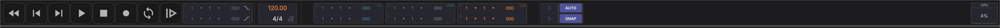
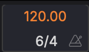

# Transport

The transport bar sits at the top of the window and is available in all views. It is a single row, with each group of controls in its own well.

## Layout

From left to right:

| Group | Contents |
|---|---|
| **Transport buttons** | Home, Previous, Next, Play, Stop, Record, Automation, Loop, Back to Arrangement |
| **Punch** | Punch In and Punch Out |
| **Tempo** | The Ableton Link chip, the tempo, the count-in, the time signature and the metronome |
| **Playhead** | The playhead position in bars, beats and ticks, with the same position as a clock beside it |
| **SEL** | The time selection, start → end |
| **LOOP** | The loop region, start → end |
| **Grid** | Grid division, **AUTO** and **SNAP** |
| **MEM** | The capture switch, meter and button (see [Capturing what you just heard](recording-comping.md#capturing-what-you-just-heard)) |
| **QWERTY keyboard** | Plays notes from the computer keyboard |
| **CPU** | The audio engine's load |

Hover the CPU readout for the audio device, sample rate, buffer size, peak load and dropouts (Xruns).

### Narrow Windows

When the window is too narrow for everything, the transport makes room in steps: the MEM meter shrinks to its dot and capture button, the clock beside the playhead goes, the Link chip shrinks to its LED, and SEL and LOOP show only their starts (hover a start to see the end). After that, whole groups leave the bar. A menu button appears at the right end, and the controls that left are in its menu: the QWERTY keyboard (**Virtual MIDI Keyboard**), **Recent Capture** and the CPU load, then **Loop** and **Back to Arrangement**, **Punch In**, **Punch Out** and **Punch Range...**, **Auto Grid** and **Snap**, and **Go Home**, **Previous** and **Next**.

## Navigation & Playback

| Button | Action | Shortcut |
|--------|--------|----------|
| **Home** | Return to the start | |
| **Previous** | Return to the start | |
| **Next** | Jump to the end | |
| **Play** | Start/stop playback | ++space++ |
| **Stop** | Stop playback and disarm automation writing | |
| **Record** | Start/stop recording | |
| **Automation** | Arm automation writing; right-click to choose the mode (see [Automation Modes](automation.md#automation-modes)) | |
| **Loop** | Toggle loop playback | |
| **Back to Arrangement** | Return from session clip playback to the arrangement position | |

To jump between markers, use **Transport > Previous Marker** (++cmd+alt+left++) and **Transport > Next Marker** (++cmd+alt+right++); on Windows and Linux, use ++ctrl+alt++ with the arrows.

Hovering a transport button shows its name and shortcut in the footer's info line.

## Loop

Enable looping with the **Loop** button. The **LOOP** readout shows the loop's start and end in bars, beats and ticks, in green while looping is on. Editing either value turns looping on.

- **Set loop from a time selection** — Make a time selection in the arrangement and press ++l++ to set the loop region to match it. With no time selection, ++l++ sets the loop to the selected clip.
- **Set loop from a clip** — Select the clip and press ++ctrl+shift+l++ (++cmd+shift+l++)
- **Go to the loop's start or end** — Press `[` or `]`. ++shift++ with the same keys goes to the time selection's start or end.

## Punch In/Out

Use punch in and punch out to record only within a specific time range. **Punch In** and **Punch Out** are two toggles. Right-click either one to set the punch range's start and end, or use **Punch Range...** in the menu when the window is narrow.

You can also right-click the timeline ruler and choose **Set Punch In Here** or **Set Punch Out Here**.

## Position Displays

The transport shows editable displays for:

- **Playhead position** — Current playback time in bars, beats and ticks. The clock beside it shows the same position in minutes and seconds.
- **SEL** — Start and end of the current time selection
- **LOOP** — Start and end of the loop region

## Tempo

The tempo (BPM) is displayed in the transport bar. You can change it by:

- Dragging the tempo value up or down
- Double-clicking it and typing a new value

## Time Signature

{ width="120" }

The time signature sits to the right of the tempo. You can change it by:

- Dragging the numerator or denominator up or down
- ++alt++-clicking a value and typing a new number

Double-click a value to reset it to 4.

## Metronome & Count-In

The metronome (click track) is the icon after the time signature. Click it, or press ++c++, to turn it on or off.

The small circle between the tempo and the time signature sets the **count-in** (pre-roll) before recording starts. Click it to open the count-in menu:

| Option | Description |
|--------|-------------|
| **Off** | Recording starts immediately |
| **1 Beat** | One beat of click before recording |
| **2 Beats** | Two beats of click before recording |
| **1 Bar** | One full bar of click before recording |
| **2 Bars** | Two full bars of click before recording |

Once a count-in is set the circle lights up, and it stays dim while count-in is off. Hovering it shows the current setting.

During count-in, the metronome plays but recording does not begin until the count-in period is complete.

## Ableton Link

The **Link** chip at the start of the tempo group switches Ableton Link on and off. With Link on, MAGDA plays in time with the other apps on your network that have Link switched on: every app shares one tempo, and tempo automation is ignored.

- The chip lights while Link is on, and its LED flashes on each beat of the session, brighter on the downbeat.
- **Play** waits until the session reaches the same point in the bar as your start position, never more than a bar. While it waits, the chip's LED and the **Play** button blink. Clips launched from stopped in the [Session View](session-view.md) wait for the same downbeat.
- The footer shows **Ableton Link · N**, where N is the number of other apps in the session. Its dot turns green once one joins. Click it to open Link's settings in **Settings > Connections**.

Start Stop Sync and the output latency offset are set in **Settings > Connections > Ableton Link** (see [Ableton Link settings](interface/connections.md#ableton-link)).

## MIDI Clock

MAGDA can drive hardware with MIDI clock, or follow a clock from another device. Both are set in **Settings > Connections > MIDI Clock** (see [MIDI Clock settings](interface/connections.md#midi-clock)).

- **Send clock to** — Tick each MIDI output that should receive clock. While the transport plays, MAGDA sends 24 clocks per beat, with Start, Continue, Stop and Song Position as playback starts, stops, loops and jumps. Clock leaves when the audio it belongs to is heard, so external gear lines up with what comes out of the speakers. A device joins on the next sixteenth note after a start or a jump, since Song Position counts in sixteenths.
- **Follow clock from** — Pick the MIDI input whose clock MAGDA follows. The project tempo follows the incoming clock, and Start, Stop, Continue and Song Position start, stop and move the transport. Playback stays locked to the clock's beat as it plays.

Only one sync source is followed at a time: choosing a clock input switches Ableton Link off, and switching Ableton Link on stops following the clock. While a clock is followed, tempo automation is ignored, as it is under Link. Sending clock works with either.

## Capture (MEM)

**MEM** keeps what you play, so you can capture it after the fact. Click MEM's dot or caption to turn capture on or off, and click the capture button beside the meter (++cmd+shift+c++) to open the capture panel. See [Capturing what you just heard](recording-comping.md#capturing-what-you-just-heard).

## QWERTY MIDI Keyboard

A small keyboard-icon toggle on the right side of the transport enables the computer-keyboard MIDI input. When on, typing on the QWERTY keyboard sends MIDI notes to the currently selected instrument track. Right-click the toggle to see the key layout.

### Key layout

Two rows of keys cover just over an octave. The lower row maps to the natural notes of the current base octave, the upper row extends one octave above.

| Row | White keys (naturals) | Black keys (sharps) |
|---|---|---|
| Lower (base octave) | `A S D F G H J` → C D E F G A B | `W E _ T Y U` → C♯ D♯ F♯ G♯ A♯ |
| Upper (base +1) | `K L` → C D | `O P` → C♯ D♯ |

Octave shift:

- `Z` — move the base octave down one
- `X` — move the base octave up one

The base octave defaults to 3, so `A` plays C3. Range is clamped to 0–8.

Modifier combinations (`⌘`, `⌃`, `⌥`) and the spacebar always pass through to regular shortcuts, so transport control and edit shortcuts keep working while the keyboard is on.

On a narrow window the toggle moves into the transport's menu as **Virtual MIDI Keyboard**.

## Grid & Snap

The grid controls how clips and edits snap to musical divisions. The grid group in the transport bar has three parts:

- **Grid division** — Click the division button (tooltip *Grid division*) to pick a fixed resolution from the menu:

    | Section | Divisions |
    |---|---|
    | **Straight** | 1/1, 1/2, 1/4, 1/8, 1/16, 1/32 |
    | **Triplet** | 1/4T, 1/8T, 1/16T, 1/32T |
    | **Dotted** | 1/2., 1/4., 1/8., 1/16., 1/32. |

    **Custom...** at the bottom opens a numerator/denominator editor that shows the nearest named division as you type.

- **AUTO** — When on, the grid resolution follows the current horizontal zoom: it picks a finer division as you zoom in and switches to whole bars when you zoom far out. The division button is dimmed while AUTO is active.
- **SNAP** — Enable or disable snapping to the grid.

The same picker is used by the bottom-panel editors ([Piano Roll](panels/piano-roll.md), [Drum Grid Editor](panels/drum-grid-editor.md), and the automation-clip editor), each with its own AUTO button.
